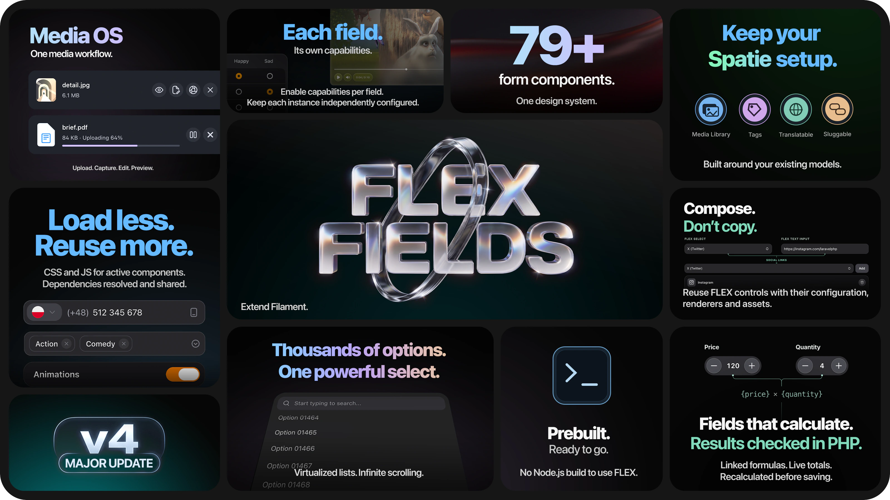
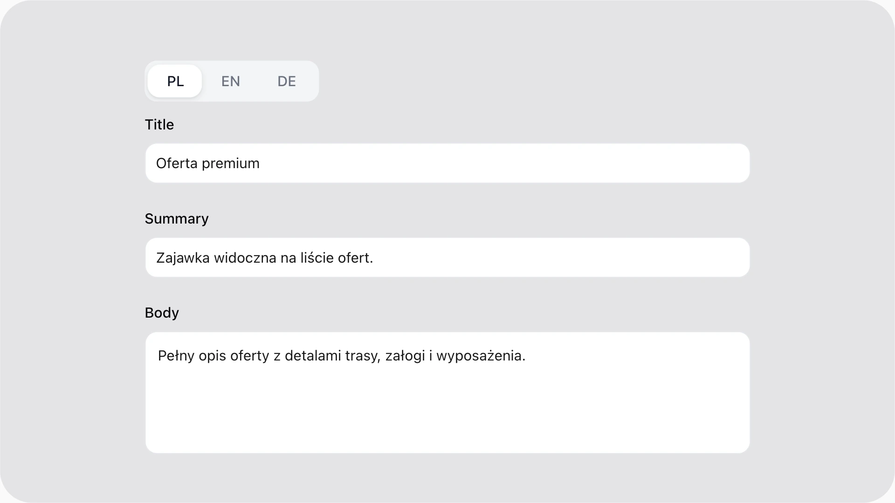
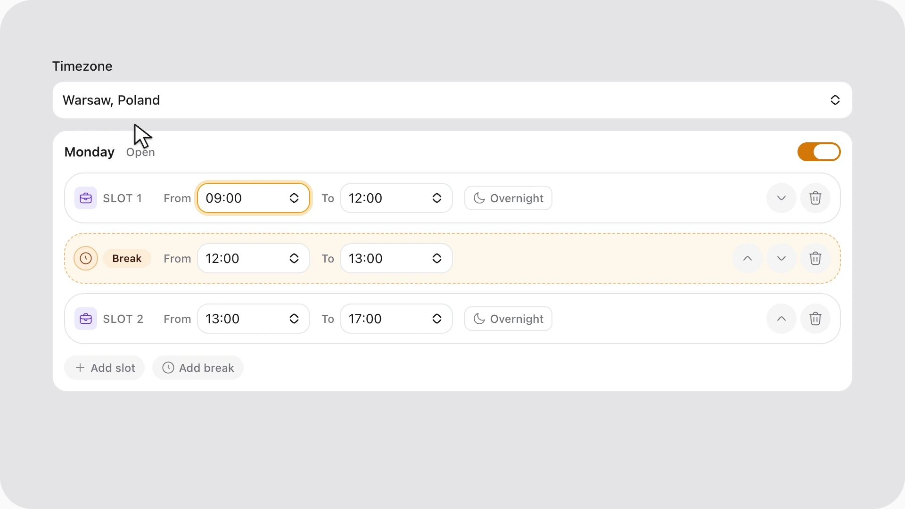
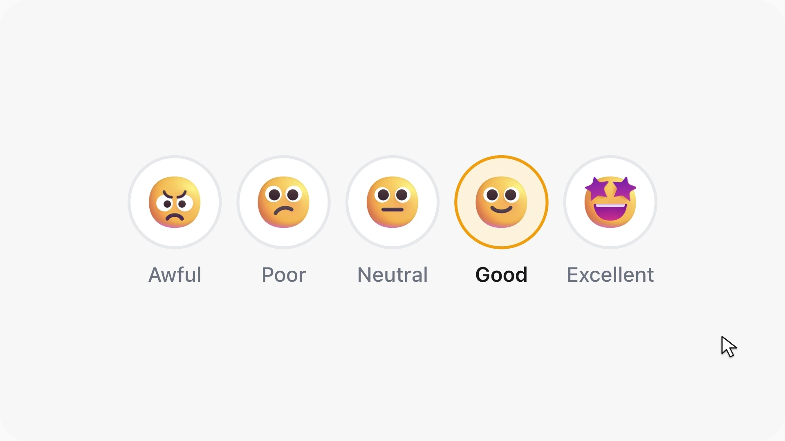
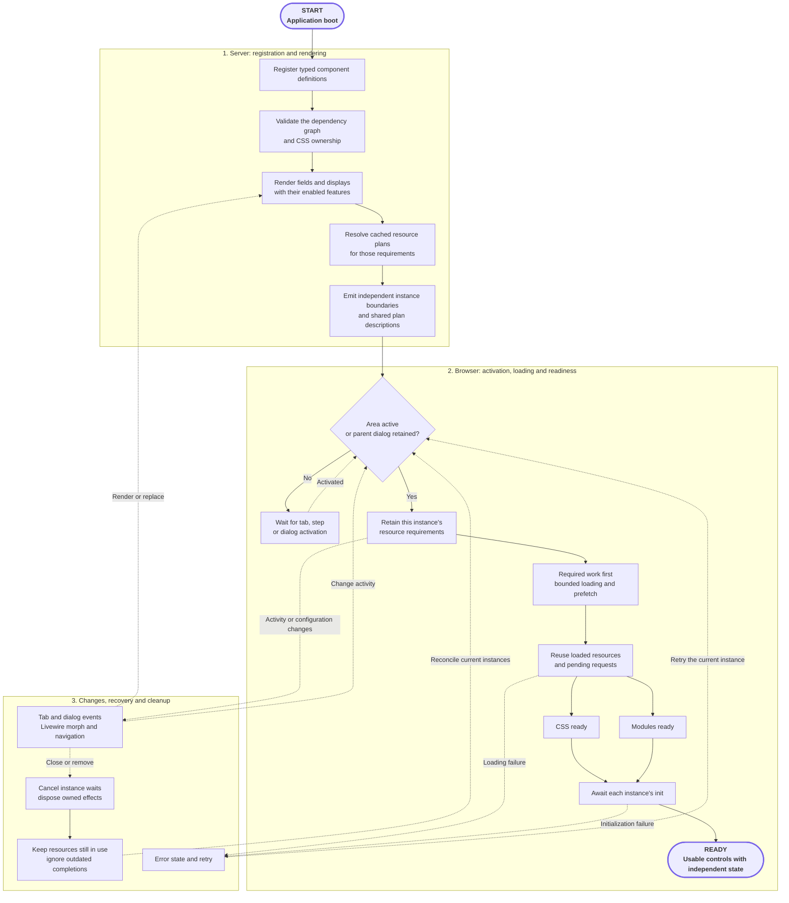

<p align="center">
  <picture>
    <source media="(prefers-color-scheme: dark)" srcset="art/readme/logo-dark.svg">
    
  </picture>
</p>

<h1 align="center">FLEX Fields<br>Advanced form components for Filament 5</h1>

<p align="center">
  <strong>79+ components for Filament 5. One design system. One media workflow.</strong>
</p>

<p align="center">
  Build consistent Laravel admin forms with advanced Filament controls and configurable JSON custom fields.<br>
  Media OS connects uploads, image processing and multilingual file information,<br>
  while active controls load and share their required CSS and JavaScript.<br>
  Optional Spatie integrations work with the models your application already uses.
</p>

<p align="center">
  <a href="https://packagist.org/packages/janczakb/filament-flex-fields"></a>
  <a href="https://packagist.org/packages/janczakb/filament-flex-fields"></a>
  <a href="https://github.com/janczakb/filament-flex-fields/stargazers"></a>
  
  <a href="LICENSE"></a>
</p>

<p align="center">
  <a href="https://demo.bjanczak.com/"></a>&nbsp;
  <a href="https://flex-fields.bjanczak.com/docs/"></a>
</p>

<p align="center">
  <a href="#component-catalog"><strong>Explore all components</strong></a> &nbsp;·&nbsp;
  <a href="#installation"><strong>Installation</strong></a> &nbsp;·&nbsp;
  <a href="#licensing"><strong>Licensing</strong></a>
</p>

<p align="center">
  <sub>This README previews FLEX Fields v4. See installation for release availability.</sub>
</p>

<p align="center">
  <a href="https://demo.bjanczak.com/">
    
  </a>
</p>

<p align="center">
  <a href="https://www.youtube.com/watch?v=BAV82Qg7-W4"><strong>Watch the FLEX Fields v4 component showcase · 4:26 →</strong></a><br>
  <sub>See real components in action: pickers, uploads, image editing, maps, signatures and more.</sub>
</p>

## Why choose FLEX Fields?

| What makes FLEX worth choosing | What it gives your application |
| --- | --- |
| **One toolkit. A consistent interface.** | A shared visual system across 79+ components, configurable field variants and sizes, and dedicated mobile layouts where the interaction needs them. |
| **Load less. Reuse more.** | Use a broad catalog without loading every component on each page. Shared resources are reused, and optional tools stay configurable for each field. |
| **Media from capture to presentation.** | Uploads, URL imports, camera capture and supported generated media connect to storage, image versions, optional workers, previews and editable file information through **Media OS**. |
| **Keep your Spatie setup.** | Optional integrations for **Media Library, Tags, Translatable and Sluggable** connect FLEX interfaces to the models your application already uses. |
| **Compose. Don't copy.** | Build your own controls from configurable FLEX children, reusing their renderers and assets. Extend a component family with table and infolist presentations when needed. |
| **Fields that calculate. Results checked in PHP.** | Define linked formulas for totals, taxes and other numeric results. Update them live and recalculate from validated inputs before saving. |

Use individual fields with ordinary model attributes, or add **managed JSON custom field groups** for configurable product attributes, CRM data and tenant settings. Managed custom fields are stored as JSON, without an EAV schema; the JSON layer is optional.

## See what you can build

<table>
  <tr>
    <td width="50%" valign="top">
      <a href="https://flex-fields.bjanczak.com/docs/translatablefields"></a>
      <p><strong>Content in your users' languages</strong><br>Switch locales and edit translated fields in one editing flow.</p>
      <p><a href="https://flex-fields.bjanczak.com/docs/translatablefields">Explore multilingual fields →</a></p>
    </td>
    <td width="50%" valign="top">
      <a href="https://flex-fields.bjanczak.com/docs/schedule-field"></a>
      <p><strong>Business hours, ready to configure</strong><br>Weekly time slots and breaks, with matching table and infolist displays.</p>
      <p><a href="https://flex-fields.bjanczak.com/docs/schedule-field">Explore weekly schedules →</a></p>
    </td>
  </tr>
  <tr>
    <td width="50%" valign="top">
      <a href="https://flex-fields.bjanczak.com/docs/signaturefield"></a>
      <p><strong>Capture a signature inside the form</strong><br>Touch, stylus and mouse input, with ink controls, undo, redo and export options.</p>
      <p><a href="https://flex-fields.bjanczak.com/docs/signaturefield">Explore signature capture →</a></p>
    </td>
    <td width="50%" valign="top">
      <a href="https://flex-fields.bjanczak.com/docs/nps-field"></a>
      <p><strong>Make feedback easy to give</strong><br>NPS, CSAT and Likert controls with segmented, pill and emoji presentations.</p>
      <p><a href="https://flex-fields.bjanczak.com/docs/nps-field">Explore ratings and surveys →</a></p>
    </td>
  </tr>
</table>

[Explore the interfaces in the live demo →](https://demo.bjanczak.com/)

## Filament file uploads, powered by Media OS

Choose how files enter your form, which image versions you generate, and which previews and metadata your users see. **Media OS** connects these settings across FLEX upload and capture tools.

<p>
  <a href="https://flex-fields.bjanczak.com/docs/flexfileupload-and-fleximageupload"></a>
</p>

### One product-photo workflow

Add product photos through file selection, URL import or camera capture. Configure named **WebP image conversions**, generate them in a worker when required, and use a chosen **thumbnail conversion** in the avatar, grid or list. Open the fullscreen viewer for a closer look and, when enabled, edit file information alongside it.

| Step | Your configuration |
| --- | --- |
| **Add & validate** | Choose sources, accepted formats, file limits and image constraints. URL-imported files enter the shared validation workflow. |
| **Store & process** | Use Laravel disks, including a configured S3 disk, or Spatie Media Library. Define named image versions and choose synchronous or queued processing. |
| **Preview & inspect** | Select a saved preview conversion, use avatar/grid/list layouts and enable the fullscreen viewer or image editor where needed. |
| **Describe & save** | Expose only the information you need: alternative text, title, caption, tags or custom FLEX fields. Choose translated fields, locales, a primary language and validation rules. |

**Native Media OS** generates image variants without Media Library. **Spatie mode** uses your model's collections and conversions. Queued processing requires a running worker; image generation requires an encoder supporting the chosen format. Originals are retained, and previews can use the available original while a conversion is pending.

For application-specific workflows, configure **staging, recovery and cleanup**, custom filenames, PHP lifecycle callbacks, processors and scanner hooks. You can attach your own scanning service; FLEX does not bundle an antivirus engine.

[Media OS guide](https://flex-fields.bjanczak.com/docs/media-capture-os) · [Image conversions & workers](https://flex-fields.bjanczak.com/docs/media-os-images) · [File information](https://flex-fields.bjanczak.com/docs/file-upload-metadata) · [Events & recovery](https://flex-fields.bjanczak.com/docs/file-upload-events-and-recovery)

## Live calculations, checked before saving

Connect prices, quantities, discounts and taxes with reusable calculation plans. **CalculatedFields** binds those plans to your form controls, keeps dependent results in sync and recalculates outputs in PHP during form saving. Submitted totals are replaced by results calculated from validated inputs.

Define input limits, choose the allowed functions and reuse the same **FormulaEngine** plan in services or actions. Chained formulas resolve in dependency order, and cyclic dependencies are rejected when the plan is created.

[Explore calculated fields and formula validation →](https://flex-fields.bjanczak.com/docs/field-intelligence)

## Intelligent asset loading

FLEX loads the resources required by active controls and shares dependencies across instances. Inactive tabs, wizard steps and closed dialogs wait until activation; each field keeps its own configuration and state.

| On your page | What FLEX does |
| --- | --- |
| Several instances of the same control | Shares CSS, JavaScript and pending loads. Each instance keeps its own values and configuration. |
| A composite control containing other controls | Resolves declared child dependencies and reuses their renderers and resources. |
| A field inside an inactive tab, wizard step or closed dialog | Waits for that area to activate before initializing its controls. |
| A field removed by Livewire, or a nested dialog closing | Disposes instance-owned listeners, timers and streams while preserving dependencies still needed by other instances. |

Editors, capture tools and other optional features follow each field's configuration. Every FLEX-enabled panel has a **shared runtime and base styles**. The package includes **prebuilt browser assets**, so normal use needs no FLEX Node.js build or custom Tailwind compilation.

[How asset loading works →](https://flex-fields.bjanczak.com/docs/asset-loading) · [Requirements & dependencies →](https://flex-fields.bjanczak.com/docs/requirements)

<details>
<summary><strong>Technical details: asset planning, loading and cleanup</strong></summary>

FLEX coordinates a dependency graph, shared loading and the lifecycle of each rendered instance. Plans are cached; resource ownership, priority queues and readiness checks respond to interactions and Livewire updates.

Read from **START** at the top. The included assets must already be published through your deployment process; this diagram follows registration, page rendering and the main browser lifecycle.



Solid arrows show the main preparation path. Dashed arrows show activation, updates, recovery and cleanup. The three layers cooperate throughout the page's lifetime; READY is an interactive state, not the end of the system's work.

This is a lifecycle overview. Release publication, transport policies and detailed failure paths have their own [deployment](https://flex-fields.bjanczak.com/docs/updating) and [asset-loading](https://flex-fields.bjanczak.com/docs/asset-loading) guidance.

Full component composition and CSS-only reuse are distinct: sharing another control's styles does not automatically start its JavaScript. Closing one instance preserves resources used by the page or other instances; evaluated JavaScript remains in the browser.

</details>

## Four optional Spatie integrations

Keep the data models your project already uses. Install and configure each integration only when you need it.

| Spatie package | What FLEX adds |
| --- | --- |
| **[Media Library](https://flex-fields.bjanczak.com/docs/media-os-spatie)** | Upload and voice-capture interfaces connected to media collections, staging, file information, preview conversions and processing status. |
| **[Tags](https://flex-fields.bjanczak.com/docs/tags-field)** | Tag selection with types, locales and search fallback. Translated names can belong to the same tag rather than a separate tag for every language. |
| **[Translatable](https://flex-fields.bjanczak.com/docs/translatablefields)** | Locale tabs and state mapping for multilingual model attributes, with selectable languages. |
| **[Sluggable](https://flex-fields.bjanczak.com/docs/slugfield-and-titleslugfield)** | A live permalink preview based on the model's slug configuration, including a chosen title language as the slug source. |

Disk-backed media, plain tags and translation maps also have modes that do not require Spatie.

## Installation

Start with **PHP 8.3+** and an existing **Filament 5** panel, using compatible Laravel and Livewire versions.

> [!NOTE]
> **FLEX Fields v4 preview:** this README describes the upcoming v4 release. A stable v4 package is not yet available on Packagist. The installation command below applies once v4 is published in your Composer repository. Follow the [release notes](https://flex-fields.bjanczak.com/docs/changelog) for availability.

**1. Install the package once v4 is available.**

```bash
composer require janczakb/filament-flex-fields:"^4.0"
```

**2. Register FLEX in your existing panel provider.**

```php
use Bjanczak\FilamentFlexFields\FilamentFlexFieldsPlugin;
use Filament\Panel;

public function panel(Panel $panel): Panel
{
    return $panel
        // Keep your existing panel configuration.
        ->plugin(FilamentFlexFieldsPlugin::make());
}
```

**3. Publish the included browser assets.**

```bash
php artisan filament:assets
```

Start with [Your first component](https://flex-fields.bjanczak.com/docs/first-component) for a walkthrough of adding, validating, saving and reopening a field.

### Advanced example: queued WebP image variants

This disk-backed image upload adds two WebP variants and a thumbnail preview to an existing form. It requires configured storage, a JSON attribute with an `array` cast, and a running queue worker.

```php
use Bjanczak\FilamentFlexFields\Filament\Forms\Components\FlexImageUpload;
use Bjanczak\FilamentFlexFields\Support\Media\Images\ImageConversion;

FlexImageUpload::make('photos')
    ->multiple()
    ->uploadLayout('grid')
    ->disk('public')
    ->directory('products')
    ->maxSize(10240)
    ->imageConversions([
        new ImageConversion('thumb', width: 250, height: 250),
        new ImageConversion('large', width: 1500, height: 1500),
    ])
    ->queueImageConversions()
    ->previewConversion('thumb');
```

`ImageConversion` defaults to WebP and fits within the specified bounds without upscaling. The field stores multiple disk paths in the JSON attribute. Spatie uploads instead define their conversions on the media model.

Standalone fields do not require managed JSON field groups. The provider registers package migrations, so review pending migrations through your normal deployment process.

[Full installation](https://flex-fields.bjanczak.com/docs/installation) · [Saving & validation](https://flex-fields.bjanczak.com/docs/data-and-validation) · [Configuration](https://flex-fields.bjanczak.com/docs/configuration) · [Updating](https://flex-fields.bjanczak.com/docs/updating)

## Find the solution your application needs

| You are building… | Start with… |
| --- | --- |
| Large searchable catalogs and contextual selections | **[SelectField](https://flex-fields.bjanczak.com/docs/selectfield)** — virtualized lists, configurable result pagination, rich option views and a mobile selection sheet. |
| Product galleries and multilingual image information | **[FLEX Upload](https://flex-fields.bjanczak.com/docs/flexfileupload-and-fleximageupload)** — Media OS, preview conversions, file information and viewer tools. |
| Inventory and asset intake | **[BarcodeScannerField](https://flex-fields.bjanczak.com/docs/barcode-scanner-field)** — camera-based QR and barcode scanning with configurable formats. |
| Opening hours and weekly availability inputs | **[ScheduleField](https://flex-fields.bjanczak.com/docs/schedule-field)** — weekly slots and breaks, with table and infolist presentation. |
| Agreements and voice notes | **[SignatureField](https://flex-fields.bjanczak.com/docs/signaturefield)** and **[VoiceNoteRecorderField](https://flex-fields.bjanczak.com/docs/voicenoterecorderfield)** — capture directly inside the form. |
| Content editing and recognizable link cards | **[FlexRichEditor](https://flex-fields.bjanczak.com/docs/flex-rich-editor)** and **[LinkPreviewField](https://flex-fields.bjanczak.com/docs/link-preview-field)** — rich content, image attachments and Open Graph previews. |
| Brand typography and font settings | **[FontSelect](https://flex-fields.bjanczak.com/docs/font-select)** — searchable Google Fonts with virtualized, paginated results and real previews loaded only for visible options and configured selections. |
| Live totals, taxes and dependent numeric fields | **[Calculated fields](https://flex-fields.bjanczak.com/docs/field-intelligence)** — reusable formulas, validated inputs and results recalculated in PHP before saving. |
| Configurable CRM or product attributes | **[Flex Field Groups](https://flex-fields.bjanczak.com/docs/flex-field-groups)** — managed custom fields stored as JSON. |
| Your own reusable component family | **[Extensions](https://flex-fields.bjanczak.com/docs/extensions)** — compose existing FLEX controls and deliver a field, table column and infolist entry with shared resources. |

## Component catalog

**79+ components, grouped by purpose.** Browse the public fields, layout components and display surfaces below. Each group links to its configuration guides; legacy aliases and abstract base classes are excluded.

### Form fields and controls

| Category | Components |
| --- | --- |
| **Text & content** | [FlexTextInput](https://flex-fields.bjanczak.com/docs/flextextinput), [FlexTextareaField](https://flex-fields.bjanczak.com/docs/flextextareafield), [FlexRichEditor](https://flex-fields.bjanczak.com/docs/flex-rich-editor)<br>[PhoneField](https://flex-fields.bjanczak.com/docs/phonefield), [CountryField](https://flex-fields.bjanczak.com/docs/countryfield), [TimezoneField](https://flex-fields.bjanczak.com/docs/timezonefield)<br>[SlugField & TitleSlugField](https://flex-fields.bjanczak.com/docs/slugfield-and-titleslugfield), [AddressAutocompleteField](https://flex-fields.bjanczak.com/docs/addressautocompletefield)<br>[FlexVerificationCode](https://flex-fields.bjanczak.com/docs/flexverificationcode), [LinkPreviewField](https://flex-fields.bjanczak.com/docs/link-preview-field), [SocialLinksField](https://flex-fields.bjanczak.com/docs/social-links-field) |
| **Numbers & ranges** | [NumberStepper](https://flex-fields.bjanczak.com/docs/numberstepper), [CalculatorField](https://flex-fields.bjanczak.com/docs/calculator-field), [CurrencyField](https://flex-fields.bjanczak.com/docs/currencyfield)<br>[FlexSlider](https://flex-fields.bjanczak.com/docs/flexslider), [TrackSlider](https://flex-fields.bjanczak.com/docs/trackslider), [PriceRangeField](https://flex-fields.bjanczak.com/docs/pricerangefield), [TrafficSplit](https://flex-fields.bjanczak.com/docs/trafficsplit) |
| **Selects & lists** | [SelectField](https://flex-fields.bjanczak.com/docs/selectfield), [UserSelect](https://flex-fields.bjanczak.com/docs/userselect), [TagsField & FlexSpatieTagsField](https://flex-fields.bjanczak.com/docs/tags-field)<br>[FontSelect](https://flex-fields.bjanczak.com/docs/font-select), [IconPickerField](https://flex-fields.bjanczak.com/docs/icon-picker-field), [DualListboxField](https://flex-fields.bjanczak.com/docs/duallistboxfield)<br>[FlexChecklist](https://flex-fields.bjanczak.com/docs/flexchecklist), [FlexRadiolist](https://flex-fields.bjanczak.com/docs/flexradiolist), [TodoListField](https://flex-fields.bjanczak.com/docs/todolistfield) |
| **Choices & switches** | [SwitchField](https://flex-fields.bjanczak.com/docs/switchfield), [SegmentControl](https://flex-fields.bjanczak.com/docs/segmentcontrol), [ChoiceCards](https://flex-fields.bjanczak.com/docs/choicecards), [ChoiceCheckboxCards](https://flex-fields.bjanczak.com/docs/choicecheckboxcards)<br>[ImageChoiceCards](https://flex-fields.bjanczak.com/docs/imagechoicecards), [BubbleChoiceField](https://flex-fields.bjanczak.com/docs/bubblechoicefield)<br>[MatrixChoiceField](https://flex-fields.bjanczak.com/docs/matrixchoicefield), [FlexMatrixTable](https://flex-fields.bjanczak.com/docs/flex-matrix-table) |
| **Dates & times** | [FlexDateField, FlexDatePicker & FlexDateTimePicker](https://flex-fields.bjanczak.com/docs/date-picker), [FlexDateRangeField](https://flex-fields.bjanczak.com/docs/date-range-picker)<br>[FlexTimeField, FlexTimeSegmentsField & FlexTimeRangeField](https://flex-fields.bjanczak.com/docs/time-picker)<br>[FlexMonthPicker, FlexYearPicker & FlexDurationField](https://flex-fields.bjanczak.com/docs/date-periods-and-duration), [ScheduleField](https://flex-fields.bjanczak.com/docs/schedule-field) |
| **Uploads & capture** | [FlexFileUpload, FlexImageUpload & FlexSpatieMediaLibraryFileUpload](https://flex-fields.bjanczak.com/docs/flexfileupload-and-fleximageupload)<br>[VoiceNoteRecorderField & VoiceNoteSpatieRecorderField](https://flex-fields.bjanczak.com/docs/voicenoterecorderfield)<br>[SignatureField](https://flex-fields.bjanczak.com/docs/signaturefield), [BarcodeScannerField](https://flex-fields.bjanczak.com/docs/barcode-scanner-field) |
| **Audio, video & card previews** | [AudioField](https://flex-fields.bjanczak.com/docs/audiofield), [VideoField](https://flex-fields.bjanczak.com/docs/videofield), [CreditCardField](https://flex-fields.bjanczak.com/docs/creditcardfield) |
| **Maps & geography** | [MapPickerField](https://flex-fields.bjanczak.com/docs/mappickerfield), [MapCoordinatesField](https://flex-fields.bjanczak.com/docs/map-coordinates), [MapDisplayField](https://flex-fields.bjanczak.com/docs/map-display), [MapMarkersField](https://flex-fields.bjanczak.com/docs/map-markers), [MapZonesField](https://flex-fields.bjanczak.com/docs/map-zones), [MapEditorField](https://flex-fields.bjanczak.com/docs/map-editor), [CountryMapField](https://flex-fields.bjanczak.com/docs/country-map-field) |
| **Color** | [ColorSwatchField](https://flex-fields.bjanczak.com/docs/colorswatchfield), [FlexColorPickerField](https://flex-fields.bjanczak.com/docs/flexcolorpickerfield) |
| **Ratings & surveys** | [RatingField](https://flex-fields.bjanczak.com/docs/ratingfield), [NpsField](https://flex-fields.bjanczak.com/docs/nps-field) |

### Layouts, tables, infolists and actions

| Category | Components |
| --- | --- |
| **Tabs & translations** | [SegmentTabs](https://flex-fields.bjanczak.com/docs/segmenttabs) with `SegmentTab`; [TranslatableFields](https://flex-fields.bjanczak.com/docs/translatablefields) with `TranslatableTab` |
| **Cards & presentation** | [ItemCard](https://flex-fields.bjanczak.com/docs/itemcard), [ItemCardGroup](https://flex-fields.bjanczak.com/docs/itemcardgroup), [ItemCardStack](https://flex-fields.bjanczak.com/docs/itemcardstack), [CoverCard](https://flex-fields.bjanczak.com/docs/covercard)<br>[ProgressBar](https://flex-fields.bjanczak.com/docs/progressbar), [ProgressCircle](https://flex-fields.bjanczak.com/docs/progresscircle) |
| **Table columns** | [UserColumn](https://flex-fields.bjanczak.com/docs/usercolumn), [RatingColumn](https://flex-fields.bjanczak.com/docs/ratingcolumn), [IconColumn](https://flex-fields.bjanczak.com/docs/iconcolumn)<br>[MapPinColumn](https://flex-fields.bjanczak.com/docs/mappickerfield), [ProgressColumn](https://flex-fields.bjanczak.com/docs/progressbar), [SignaturePreviewColumn](https://flex-fields.bjanczak.com/docs/signaturefield), [StatusChipColumn](https://flex-fields.bjanczak.com/docs/status-chip-column)<br>[ScheduleColumn](https://flex-fields.bjanczak.com/docs/schedule-field), [FlexMediaImageColumn](https://flex-fields.bjanczak.com/docs/media-capture-os), [FlexSpatieMediaLibraryImageColumn](https://flex-fields.bjanczak.com/docs/media-os-spatie) |
| **Infolist entries** | [ScheduleEntry](https://flex-fields.bjanczak.com/docs/schedule-field), [FlexMediaImageEntry](https://flex-fields.bjanczak.com/docs/media-capture-os), [FlexSpatieMediaLibraryImageEntry](https://flex-fields.bjanczak.com/docs/media-os-spatie) |
| **Actions** | [Action](https://flex-fields.bjanczak.com/docs/hold-confirm-action), including `holdConfirm()`; `ActionGroup` |

For custom compositions, [CompositeField and the extension guides](https://flex-fields.bjanczak.com/docs/extensions/child-select) show how to reuse controls with their configuration, renderers and assets.

## Questions before you install

<details>
<summary><strong>Can I use just one component?</strong></summary>

Yes. Add individual FLEX components to an existing Filament form. Ordinary fields can use existing model attributes; managed JSON field groups are optional.

</details>

<details>
<summary><strong>Will every component load on every page?</strong></summary>

No. Installing FLEX includes its distributed files and required Composer dependencies. The browser loads component assets as they are needed, together with the panel's shared base resources.

</details>

<details>
<summary><strong>Do I need Node.js or a custom Tailwind build?</strong></summary>

Not for normal use. FLEX ships prebuilt browser assets; publish them with `php artisan filament:assets`. Authors building their own extension assets may need a build process.

</details>

<details>
<summary><strong>Is Spatie Media Library required?</strong></summary>

No. Use Laravel disks and native Media OS conversions, or enable the optional Spatie adapter. The same principle applies to optional Tags, Translatable and Sluggable integrations: install the packages you choose to use.

</details>

<details>
<summary><strong>Can I configure thumbnails and background image processing?</strong></summary>

Yes. Define your conversions and choose the one used for saved previews. Browser-generated thumbnails for new files are optional and disabled by default. Native conversions can be queued; Spatie conversions use the model's queue configuration. Pending conversions may fall back to the available original.

</details>

<details>
<summary><strong>What happens when I update the package?</strong></summary>

Update through Composer and publish matching browser assets through your Filament deployment hook or `php artisan filament:assets`. Preserve your application settings, review pending migrations and restart relevant workers. See [Updating & deployment](https://flex-fields.bjanczak.com/docs/updating).

</details>

<details>
<summary><strong>Can I create my own components?</strong></summary>

Yes. Compose existing FLEX controls using their configuration APIs and reuse their renderers and assets. A component family can provide a form field, table column and infolist entry. Follow the [extension tutorials](https://flex-fields.bjanczak.com/docs/extensions) for the supported registration and build contracts.

</details>

## Licensing

**Source-available, with permitted free use.** All plans provide the same package features. Choose by how you use the software, who owns the application and whether you distribute it.

| Plan | Price | What it covers |
| --- | --- | --- |
| **Permitted Free Use** | **Free** | Qualifying personal, educational, research, internal operational and evaluation uses, plus defined bespoke-client routes under LICENSE §1.7. |
| **Single Product** | **$249 one-time** | One named hosted commercial Product for one named licensee. |
| **Unlimited Company** | **$699 one-time** | Current and future hosted Products of one named company or sole proprietor. |
| **Enterprise Group** | **$1,499 one-time** | Hosted Products across a named parent and its qualifying 100%-owned subsidiaries. |
| **Custom / OEM / Redistribution** | **From $2,999; quoted individually** | Customer installations, distribution and other rights expressly agreed in the grant. |

Prices are USD, excluding applicable taxes. Standard paid plans provide perpetual use within their licensed scope, with no mandatory renewal. Enterprise Group does not include OEM or external customer-installation rights. Public source access is not an unrestricted open-source grant.

[Compare plans](COMMERCIAL.md) · [Full license terms](LICENSE) · [Request a license](https://flex-fields.bjanczak.com/docs/request-license)

## Build your next Filament form with FLEX

Find the component your application needs. Try its interface, choose your configuration and follow a working example.

**[Try the live demo](https://demo.bjanczak.com/)** · **[Read the documentation](https://flex-fields.bjanczak.com/docs/)** · **[Get started](https://flex-fields.bjanczak.com/docs/quickstart)**

[Changelog](CHANGELOG.md) · [Report an issue](https://github.com/janczakb/filament-flex-fields/issues) · [Support](SUPPORT.md) · [Contributing](CONTRIBUTING.md) · [Code of conduct](CODE_OF_CONDUCT.md)

If FLEX helps your project, [star the repository](https://github.com/janczakb/filament-flex-fields) to help other Filament developers discover it.

© 2026 Bartłomiej Janczak. [Third-party acknowledgments](CREDITS.md).
