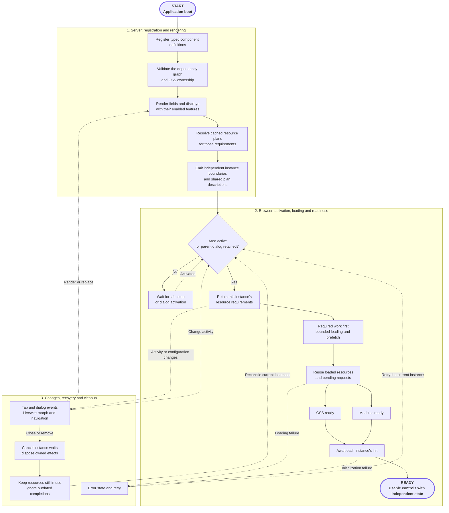

**Use the controls your form needs without loading the whole catalog.** FLEX resolves active components, their declared dependencies and the optional features of each instance. Repeated controls share browser resources while keeping independent values and configuration.

## How the asset manager works

FLEX coordinates three connected layers: **dependency planning**, **shared loading and readiness**, and **instance lifecycle management**. That allows a broad component library to serve repeated fields, optional tools and changing forms without treating every control as a separate bundle.

Start at **START**. Before opening the page, publish the included browser files through your normal [deployment process](/docs/updating). The diagram then follows registration and rendering on the server, followed by activation and ongoing coordination in the browser.

**Solid arrows** show the main preparation path. **Dashed arrows** show activation, updates, recovery and cleanup. **READY** means the current controls are usable; the lifecycle continues as users interact with the page.

Use the diagram's zoom controls or open it fullscreen to follow individual paths.

<AccordionGroup>
  <Accordion title="1. Plan dependencies before loading" icon="git-branch">
    Component definitions declare owned styles, reused styles, child components and optional capabilities. FLEX checks the dependency graph and style ownership, then resolves reusable resource plans for the features enabled on each field. Repeated requirements can share plan descriptions, while every rendered field or display keeps its own instance boundary.

    Shared styles and full component composition have different effects: reusing a control's CSS does not automatically start its JavaScript. See [composition and asset ownership](/docs/extensions/asset-ownership) when building an extension.
  </Accordion>
  <Accordion title="2. Coordinate shared loading and readiness" icon="layers">
    Active instances retain the resources they need. Required interaction work takes priority over bounded prefetch. Already available resources are reused, and several instances can share a pending load while keeping their own waiting state.

    Styles, modules and each active instance's initialization must become ready. An inactive area waits for activation; a parent dialog suspended beneath its child retains its required resources. This is separate from viewport scrolling: an active field below the fold remains active.
  </Accordion>
  <Accordion title="3. Keep updates, recovery and cleanup local" icon="refresh-cw">
    Tab changes, dialogs, Livewire updates and navigation can change which instances are active or replace their configuration. FLEX reconciles their requirements and ignores outdated completions rather than letting an old operation mark a replacement ready.

    When a field closes or is removed, its tracked waits, listeners, timers and capture streams can be disposed. Other instances keep their interest in shared resources. Failures retain an error state with retry where the field or surface supports it. Already evaluated JavaScript stays in the browser; closing a control does not unload the module.
  </Accordion>
</AccordionGroup>

<Note>
  This diagram shows the main runtime lifecycle, not every internal operation. Asset publication, cache configuration, transport policies and detailed failure handling are explained in the relevant sections and [deployment guidance](/docs/updating).
</Note>

## Separate the four costs

| Cost | What affects it | What FLEX does |
| --- | --- | --- |
| Installation | Composer packages and distributed files | Includes prebuilt browser files; optional integrations have separate setup |
| Browser download | Resources needed by the current page | Selects component resources and shares common dependencies |
| Initialization | Active controls and enabled features | Defers inactive areas and separates loading from initialization |
| Your application work | Queries, file sizes, conversion jobs and external services | Provides configuration for providers and workflows; your data and infrastructure still matter |

<Note>
  A FLEX-enabled panel has shared runtime code and base styles. Selective loading avoids making every component's resources part of every page; it does not mean zero baseline JavaScript or zero installation cost.
</Note>

## Explore the Asset Manager

<CardGroup cols={2}>
  <Card title="Shared resources & features" icon="layers" href="/docs/assets/sharing">Independent fields, shared CSS and modules, and optional capabilities per instance.</Card>
  <Card title="Tabs, modals & Livewire" icon="refresh-cw" href="/docs/assets/lifecycle">Activation, nested dialogs, readiness, recovery and owner cleanup.</Card>
  <Card title="Performance choices" icon="gauge" href="/docs/assets/performance">Bounded preparation, large datasets and appropriately sized previews.</Card>
  <Card title="Publish & diagnose" icon="package-check" href="/docs/assets/deployment">Publish matching release files and inspect resource requirements.</Card>
</CardGroup>

For CDN origins and integrity, see [Asset delivery](/docs/extensions/asset-delivery). Extension authors can continue with [composition and asset ownership](/docs/extensions/asset-ownership).
