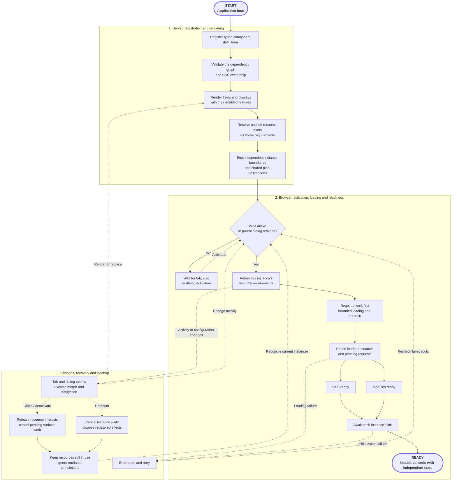

**Use the controls your form needs without loading the whole catalog.** FLEX resolves active components, their declared dependencies and the optional features of each instance. Repeated controls share browser resources while keeping independent values and configuration.

## Add a field. FLEX handles its resources.

After [installation](/docs/installation), add a FLEX control to your existing
Filament form and configure the features you want. The included components already
declare their dependencies. FLEX handles resource planning, shared loading and
activation as your users move between tabs, steps and dialogs.

- **Start with one control.** Keep your existing Resource, model attributes and native Filament fields.
- **Enable the features you need.** An editor or camera belongs to the upload instance where you enable it.
- **Use the included build.** Publish the prebuilt assets with your application; ordinary usage needs no FLEX-specific Node.js or Tailwind build.

There is no dependency graph or loading budget to configure before using a
built-in field. The sections below explain what FLEX manages for you. If you
want to start building, go straight to [your first component](/docs/first-component).

## Watch ownership in action

  <iframe
    style={{ position: 'absolute', inset: 0, width: '100%', height: '100%', border: 0, borderRadius: '12px' }}
    src="https://www.youtube-nocookie.com/embed/KufHFWijeCc"
    title="FLEX Asset Manager — narrated ownership, readiness and cleanup demonstration"
    loading="lazy"
    referrerPolicy="strict-origin-when-cross-origin"
    allow="encrypted-media; picture-in-picture; fullscreen"
    allowFullScreen
  ></iframe>

[Watch on YouTube](https://www.youtube.com/watch?v=KufHFWijeCc)

**5 minutes 45 seconds · English narration · Full HD.** Press play to hear the explanation.

These separate recorded examples use real FLEX controls and native Filament
surfaces. Within each example, clicks, pointer drawing and scrolling run at their
original speed. Chapter cards identify the cuts between examples. The inspector
shows actual resource ownership, requests and registered SDK effects.

<Info>
  **Loading is deliberately paused for the demonstration.** Visible test controls
  hold CSS, modules and initialization so you can inspect each stage. The long
  skeleton states show those controlled pauses, not a required loading duration.
</Info>

<Accordion title="How the controlled examples were recorded">
  The capture stream is synthetic; no camera is accessed. The transport failure
  is intentional, and the negative publication check changes an isolated copy
  only. The queue example runs the actual scheduler with two configured loading
  slots to make admission order visible; it is not a download-speed or frame-rate
  benchmark. These controls belong to the demonstration, not to your form setup.
</Accordion>

| Time | Recorded example |
| --- | --- |
| [00:00](https://www.youtube.com/watch?v=KufHFWijeCc&t=0s) | Resource ownership and retirement. |
| [00:32](https://www.youtube.com/watch?v=KufHFWijeCc&t=32s) | CSS sharing versus interactive modules. |
| [01:01](https://www.youtube.com/watch?v=KufHFWijeCc&t=61s) | CSS, module and initialization readiness. |
| [01:39](https://www.youtube.com/watch?v=KufHFWijeCc&t=99s) | Close during module loading. |
| [02:02](https://www.youtube.com/watch?v=KufHFWijeCc&t=122s) | Registered side-effect cleanup. |
| [02:29](https://www.youtube.com/watch?v=KufHFWijeCc&t=149s) | Outdated initialization is ignored. |
| [02:57](https://www.youtube.com/watch?v=KufHFWijeCc&t=177s) | Nested parents retain resources. |
| [03:26](https://www.youtube.com/watch?v=KufHFWijeCc&t=206s) | Controlled failure and real retry. |
| [03:51](https://www.youtube.com/watch?v=KufHFWijeCc&t=231s) | Livewire navigation and new consumers. |
| [04:15](https://www.youtube.com/watch?v=KufHFWijeCc&t=255s) | Independent table-cell ownership. |
| [04:35](https://www.youtube.com/watch?v=KufHFWijeCc&t=275s) | Bounded queue and required-work priority. |
| [05:04](https://www.youtube.com/watch?v=KufHFWijeCc&t=304s) | Intact and mismatched publication checks. |

The walkthrough focuses on the lifecycle FLEX adds around dynamic controls:
shared resources stay available to the instances that need them, outdated work
cannot reveal a replacement dialog, and registered effects are cleaned up when
their instance is removed. Evaluated JavaScript remains available for reuse;
managed styles can retire after their last owner leaves.

<Accordion title="Read the English narration">

### 00:00 — Resource ownership and retirement

Watch what happens when the last field disappears. FLEX tracks the instances that still need each resource. Removing one signature field keeps its shared stylesheet available to the other. Removing the last owner retires that managed CSS, while application styles remain untouched. Restore the field, and its JavaScript module is reused. This ownership lifecycle goes beyond simply loading a file on demand.

### 00:32 — CSS sharing versus interactive modules

This color picker shares the Text Input stylesheet, but does not import the Text Input JavaScript. The counters show that distinction. Enable the format selector: this instance now acquires Select styles and its interactive module. Leaving that tab releases its interests, while already evaluated JavaScript remains reusable. Dependencies follow the capabilities actually enabled on each instance.

### 01:01 — CSS, module and initialization readiness

These two extension instances compose real FLEX Select and Text Input controls. The stylesheet response is deliberately held. Removing one instance through Livewire leaves one owner waiting on the same transfer. Release CSS: the stylesheet is ready, but the JavaScript module is still held. Release the module: initialization now starts, and the form remains covered. Only completing the current initialization reveals the prepared controls. These are three separate readiness stages, not a timed reveal.

### 01:39 — Close during module loading

Now close the window while its module is still loading. Its resource interests are released. Open a replacement, then allow the shared request to finish. The old opening stays closed; only the current window can continue preparing. A completed network request is not permission to reveal an obsolete surface.

### 02:02 — Registered side-effect cleanup

The extension owns a timer, event listeners, a worker, and a synthetic capture stream through the public SDK. No camera is accessed. Unmounting the extension disposes its registered effects. The live track ends, timer ticks stop, and another test event no longer reaches the removed listener. The independent Select on the page keeps its styles.

### 02:29 — Outdated initialization is ignored

What if a window closes before initialization finishes? Cancel this pending instance, then open a replacement. Completing the old initialization must not mark either the discarded root or the replacement ready. The new window keeps waiting for its own initialization. Complete that current attempt, and only the current instance becomes ready. Each lifetime has its own readiness.

### 02:57 — Nested parents retain resources

Resource ownership also follows the modal hierarchy. The page and review window share signature styles. Typography opens above the review, and a deadline opens one level deeper. Suspended parents keep their required resources. Closing the deadline retires its exclusive calendar CSS; closing typography releases its font styles. The review still draws normally, and closing it preserves the underlying page.

### 03:26 — Controlled failure and real retry

This failure is intentional: one font stylesheet request is blocked for the demonstration. The runtime shows its actual error and retry control instead of presenting unprepared fields as ready. Retry prepares the fields successfully while the page and parent retain their signature resources. No failure badge or recovery result is simulated.

### 03:51 — Livewire navigation and new consumers

Livewire navigation replaces page content, but ownership must continue working. Navigate away: departed fields release their stylesheet. Return, then activate another tab: new instances acquire their requirements and the already evaluated module is reused in the document session. Application styling remains independent of this component cleanup.

### 04:15 — Independent table-cell ownership

Table cells are owners too. Fifty records produce one hundred and fifty boundaries, sharing their column styles. Scrolling keeps rendered rows active. Reduce the table to one record, then remove it. Styles retire only when their last owners leave.

### 04:35 — Bounded queue and required-work priority

This is the real scheduler, shown with two loading slots for a controlled example. Background prefetch occupies one slot; required field work uses the other. When a slot opens, queued required work starts before the remaining speculative jobs. An oversized preload is rejected by the configured byte budget. These limits manage admission; they do not promise a particular frame rate or download speed.

### 05:04 — Intact and mismatched publication checks

Typed definitions declare shared styles, full composition, and optional capabilities. Assets ship prebuilt and versioned, so standard use needs no FLEX-specific Node build. Run the actual publication check: this installation reports five hundred and eighty artifacts and zero errors. Now check an isolated copy with one deliberately changed artifact. The doctor rejects the mismatch. Checking the intact publication succeeds again. This verifies the published files; it does not certify your application's data or policies.

</Accordion>

## How the asset manager works

FLEX coordinates three connected layers: **dependency planning**, **shared loading and readiness**, and **instance lifecycle management**. That allows a broad component library to serve repeated fields, optional tools and changing forms without treating every control as a separate bundle.

Start at **START**. Before opening the page, publish the included browser files through your normal [deployment process](/docs/updating). The diagram then follows registration and rendering on the server, followed by activation and ongoing coordination in the browser.

**Solid arrows** show the main preparation path. **Dashed arrows** show activation, updates, recovery and cleanup. **READY** means the current controls are usable; the lifecycle continues as users interact with the page.

Use the diagram's zoom controls or open it fullscreen to follow individual paths.

<AccordionGroup>
  <Accordion title="1. Plan dependencies before loading" icon="git-branch">
    Component definitions declare owned styles, reused styles, child components and optional capabilities. FLEX checks the dependency graph and style ownership, then resolves reusable resource plans for the features enabled on each field. Repeated requirements can share plan descriptions, while every rendered field or display keeps its own instance boundary.

    Shared styles and full component composition have different effects: reusing a control's CSS does not automatically start its JavaScript. See [composition and asset ownership](/docs/extensions/asset-ownership) when building an extension.
  </Accordion>
  <Accordion title="2. Coordinate shared loading and readiness" icon="layers">
    Active instances retain the resources they need. Required interaction work takes priority over bounded prefetch. Already available resources are reused, and several instances can share a pending load while keeping their own waiting state.

    Styles, modules and each active instance's initialization must become ready. An inactive area waits for activation; a parent dialog suspended beneath its child retains its required resources. This is separate from viewport scrolling: an active field below the fold remains active.
  </Accordion>
  <Accordion title="3. Keep updates, recovery and cleanup local" icon="refresh-cw">
    Tab changes, dialogs, Livewire updates and navigation can change which instances are active or replace their configuration. FLEX reconciles their requirements and ignores outdated completions rather than letting an old operation mark a replacement ready.

    Closing a surface releases its resource interests and cancels pending surface work; it need not destroy a still-mounted factory. Actual unmount disposes the instance’s registered listeners, timers, subscriptions and streams. Other instances keep their interest in shared resources. Failures retain an error state with retry where the field or surface supports it. Already evaluated JavaScript stays in the browser; closing a control does not unload the module.
  </Accordion>
</AccordionGroup>

<Note>
  This diagram shows the main runtime lifecycle, not every internal operation. Asset publication, cache configuration, transport policies and detailed failure handling are explained in the relevant sections and [deployment guidance](/docs/updating).
</Note>

## Fit FLEX into your application

| Area | What FLEX provides | Your application setup |
| --- | --- | --- |
| Deployment | Prebuilt, versioned browser assets | Publish the files matching the installed package |
| Browser resources | Shared runtime and base styles, plus selected component dependencies | Configure the controls and features your form needs |
| Dynamic forms | Activation, readiness and resource ownership across changing surfaces | Use your Filament tabs, steps and dialogs |
| Data and media | Configurable providers, storage and processing workflows | Connect your queries, disks and any selected queue workers |

For deployment verification and troubleshooting, [inspect the published release
or a component's dependencies](/docs/assets/deployment). These tools help you
answer a specific setup question without manually tracing the whole runtime.

## Explore the Asset Manager

<CardGroup cols={2}>
  <Card title="Shared resources & features" icon="layers" href="/docs/assets/sharing">Independent fields, shared CSS and modules, and optional capabilities per instance.</Card>
  <Card title="Tabs, modals & Livewire" icon="refresh-cw" href="/docs/assets/lifecycle">Activation, nested dialogs, readiness, recovery and owner cleanup.</Card>
  <Card title="Performance choices" icon="gauge" href="/docs/assets/performance">Bounded preparation, large datasets and appropriately sized previews.</Card>
  <Card title="Publish & diagnose" icon="package-check" href="/docs/assets/deployment">Publish matching release files and inspect resource requirements.</Card>
</CardGroup>

For CDN origins and integrity, see [Asset delivery](/docs/extensions/asset-delivery). Extension authors can continue with [composition and asset ownership](/docs/extensions/asset-ownership).
