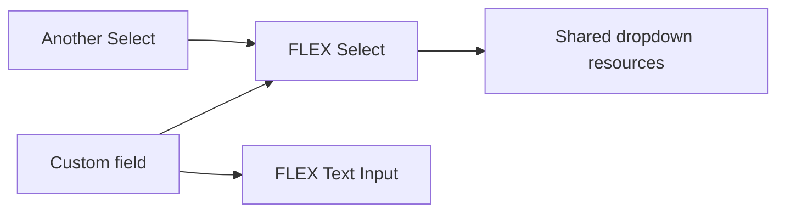

## One field does not load the whole toolkit

A form with a default signature pad needs that control and its declared resources. It does not need barcode scanning or voice recording simply because those components are available in the package.

FLEX uses prebuilt resources distributed with the package. [Installation](/docs/installation) publishes those files through Filament. Ordinary use does not require a separate package build in your Laravel application.

## Repeated controls share resources, not state

Consider a custom field containing Select and Text Input, next to another standalone Select:



The declared dependencies are resolved together. Both Select instances can use the same CSS and modules; each still has its own selected value, options, settings and rendered HTML.

When several controls need a file that is already loading, they can share the pending work. A failed request or canceled preload may still require a retry. Resource reuse is not a claim that the browser can never request a file again.

Repeated fields can also reference shared descriptions of their asset requirements instead of repeating the complete description with every field. Each field, table cell and display retains an independent instance boundary.

### Composition without copied implementations

Use the real child control's renderer and PHP configuration. The parent declares its dependencies, including dependencies of its children. FLEX does not infer a dependency from arbitrary copied HTML.

- **Full composition:** `uses` declares an interactive child component.
- **Shared styling:** `stylesFrom` reuses another component's CSS without automatically enabling its JavaScript.
- **Shared build modules:** stable module identities and the runtime SDK allow extensions to reuse common implementations.
- **Checked definitions:** invalid references, dependency cycles and conflicting style ownership can be rejected during registration.

See [asset ownership](/docs/extensions/asset-ownership), [real child configuration](/docs/extensions/child-php-api) and [extension builds](/docs/extensions/build). Sharing cannot remove code an author has manually copied into a different bundle.

## Optional features belong to the configured field

These two uploaders have different needs:

```php
use Bjanczak\FilamentFlexFields\Filament\Forms\Components\FlexImageUpload;

$fields = [
    FlexImageUpload::make('cover')
        ->imagesOnly()
        ->imageEditor(),

    FlexImageUpload::make('reference_photo')
        ->imagesOnly(),
];
```

The first field enables editing; the second does not gain that feature because another upload uses it. Editors, capture tools and extension features can have their own lazy entry points.

Preparing a module and initializing a control are different operations. A resource may be prepared ahead of an interaction without starting every hidden control. The field configuration and its feature contract determine the activation point.

## Continue reading

[Asset Manager overview](/docs/asset-loading) · [Resource sharing](/docs/assets/sharing) · [Activation & cleanup](/docs/assets/lifecycle) · [Performance](/docs/assets/performance) · [Publish & diagnose](/docs/assets/deployment)
