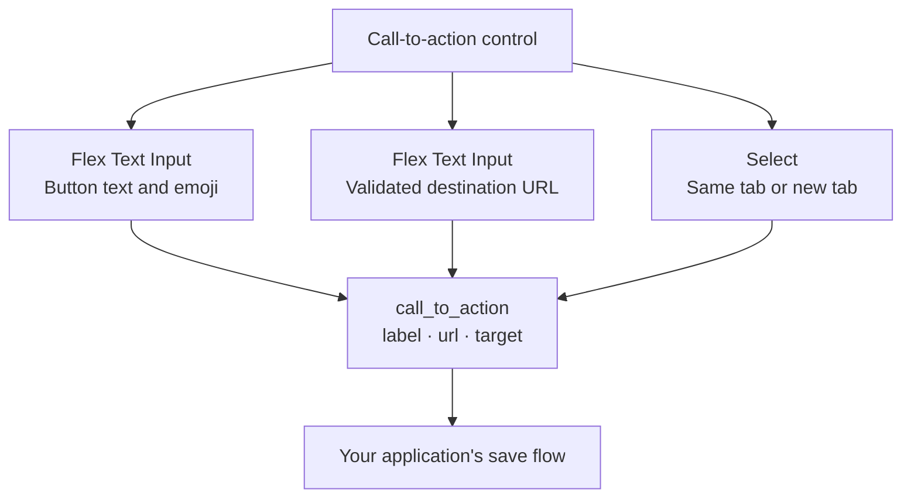
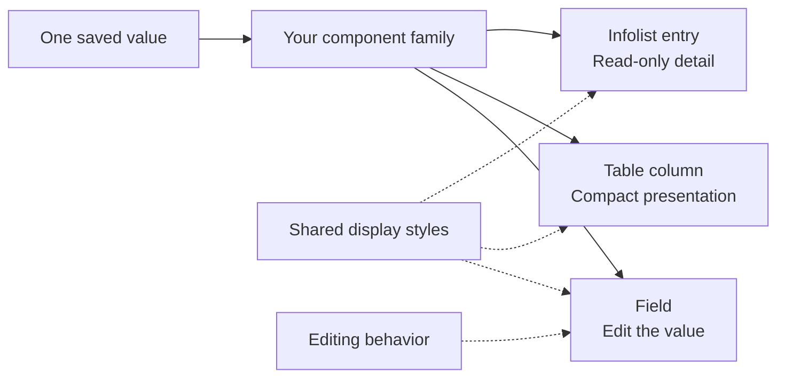
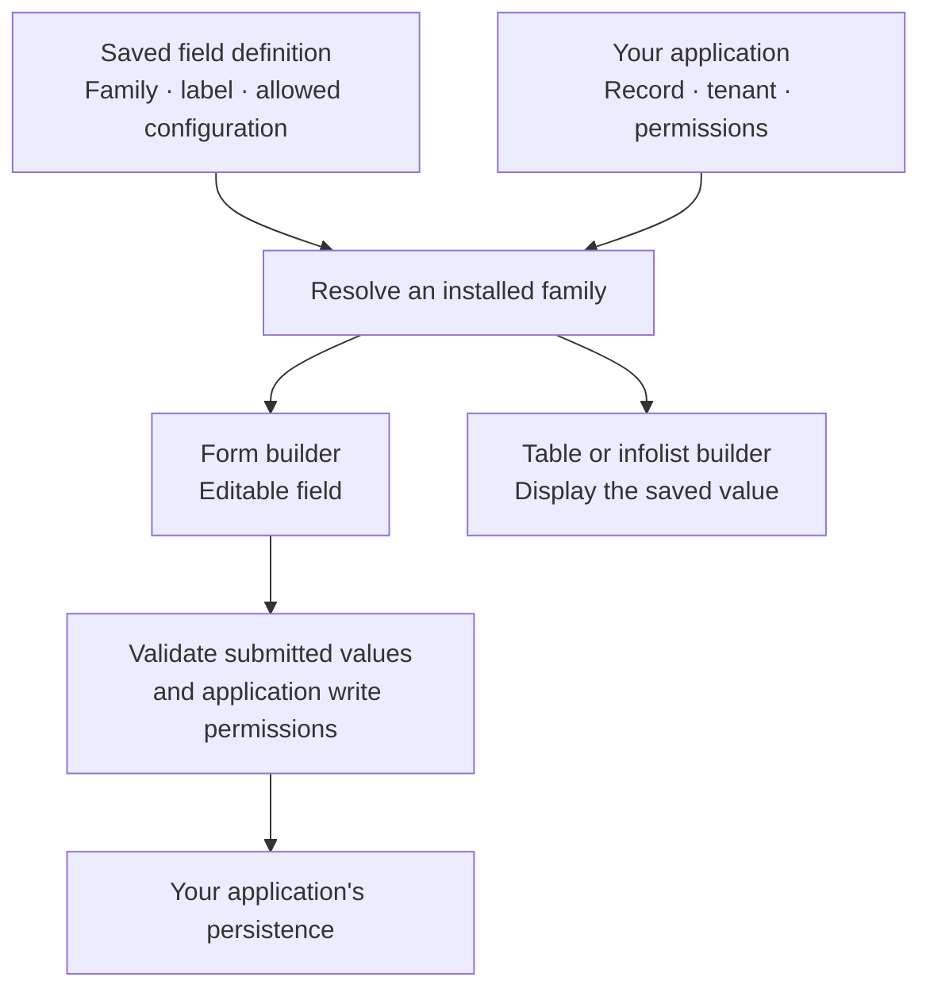

<script type="application/ld+json">
{JSON.stringify({
  "@context": "https://schema.org",
  "@graph": [
    {
      "@type": "WebPage",
      "@id": "https://flex-fields.bjanczak.com/docs/extensions#webpage",
      "url": "https://flex-fields.bjanczak.com/docs/extensions",
      "name": "Build your own FLEX components",
      "mainEntity": {
        "@id": "https://flex-fields.bjanczak.com/docs/extensions#article"
      }
    },
    {
      "@type": "TechArticle",
      "@id": "https://flex-fields.bjanczak.com/docs/extensions#article",
      "url": "https://flex-fields.bjanczak.com/docs/extensions",
      "headline": "Build custom Laravel Filament components with FLEX Fields",
      "description": "Compose existing fields, build reusable component families and follow a narrated custom component workshop.",
      "inLanguage": "en",
      "mainEntityOfPage": {
        "@id": "https://flex-fields.bjanczak.com/docs/extensions#webpage"
      },
      "publisher": {
        "@type": "Organization",
        "name": "FLEX Fields",
        "url": "https://flex-fields.bjanczak.com/"
      },
      "video": {
        "@id": "https://flex-fields.bjanczak.com/docs/extensions#video"
      }
    },
    {
      "@type": "VideoObject",
      "@id": "https://flex-fields.bjanczak.com/docs/extensions#video",
      "name": "Laravel Filament 5: Build Custom Form Components from Scratch | FLEX Fields",
      "description": "A narrated, step-by-step workshop building a campaign brief component and a reusable Composer package with real FLEX child fields, custom CSS and JavaScript, typed options, table and infolist views, translations, protected routes, AI guidance and validated schema migrations.",
      "thumbnailUrl": [
        "https://i.ytimg.com/vi/m4V_R7YxTP4/maxresdefault.jpg"
      ],
      "uploadDate": "2026-10-17T20:09:36+02:00",
      "duration": "PT1H4M33S",
      "url": "https://www.youtube.com/watch?v=m4V_R7YxTP4",
      "embedUrl": "https://www.youtube-nocookie.com/embed/m4V_R7YxTP4",
      "width": 1920,
      "height": 1080,
      "inLanguage": "en",
      "isPartOf": {
        "@id": "https://flex-fields.bjanczak.com/docs/extensions#article"
      },
      "creator": {
        "@type": "Person",
        "name": "Bartłomiej Janczak",
        "url": "https://www.youtube.com/@bjanczak"
      },
      "hasPart": [
        {
          "@type": "Clip",
          "name": "Generate a custom Filament field with Artisan",
          "startOffset": 0,
          "endOffset": 124,
          "url": "https://www.youtube.com/watch?v=m4V_R7YxTP4&t=0s"
        },
        {
          "@type": "Clip",
          "name": "Reuse the real FLEX Text Input",
          "startOffset": 124,
          "endOffset": 169,
          "url": "https://www.youtube.com/watch?v=m4V_R7YxTP4&t=124s"
        },
        {
          "@type": "Clip",
          "name": "Configure a single Select field",
          "startOffset": 169,
          "endOffset": 215,
          "url": "https://www.youtube.com/watch?v=m4V_R7YxTP4&t=169s"
        },
        {
          "@type": "Clip",
          "name": "Configure the same Select as a searchable multi-select",
          "startOffset": 215,
          "endOffset": 274,
          "url": "https://www.youtube.com/watch?v=m4V_R7YxTP4&t=215s"
        },
        {
          "@type": "Clip",
          "name": "Position child fields in a Blade layout",
          "startOffset": 274,
          "endOffset": 316,
          "url": "https://www.youtube.com/watch?v=m4V_R7YxTP4&t=274s"
        },
        {
          "@type": "Clip",
          "name": "Add your component's own JavaScript behavior",
          "startOffset": 316,
          "endOffset": 394,
          "url": "https://www.youtube.com/watch?v=m4V_R7YxTP4&t=316s"
        },
        {
          "@type": "Clip",
          "name": "Show missing data and publication readiness",
          "startOffset": 394,
          "endOffset": 428,
          "url": "https://www.youtube.com/watch?v=m4V_R7YxTP4&t=394s"
        },
        {
          "@type": "Clip",
          "name": "Build a copyable campaign brief",
          "startOffset": 428,
          "endOffset": 520,
          "url": "https://www.youtube.com/watch?v=m4V_R7YxTP4&t=428s"
        },
        {
          "@type": "Clip",
          "name": "Clean up listeners and handle async feedback",
          "startOffset": 520,
          "endOffset": 593,
          "url": "https://www.youtube.com/watch?v=m4V_R7YxTP4&t=520s"
        },
        {
          "@type": "Clip",
          "name": "Style your custom component with CSS",
          "startOffset": 593,
          "endOffset": 825,
          "url": "https://www.youtube.com/watch?v=m4V_R7YxTP4&t=593s"
        },
        {
          "@type": "Clip",
          "name": "Build the extension's JavaScript and CSS assets",
          "startOffset": 825,
          "endOffset": 911,
          "url": "https://www.youtube.com/watch?v=m4V_R7YxTP4&t=825s"
        },
        {
          "@type": "Clip",
          "name": "Register dependencies and asset ownership",
          "startOffset": 911,
          "endOffset": 1052,
          "url": "https://www.youtube.com/watch?v=m4V_R7YxTP4&t=911s"
        },
        {
          "@type": "Clip",
          "name": "Connect live previews to the shared form state",
          "startOffset": 1052,
          "endOffset": 1295,
          "url": "https://www.youtube.com/watch?v=m4V_R7YxTP4&t=1052s"
        },
        {
          "@type": "Clip",
          "name": "Try the campaign brief builder",
          "startOffset": 1295,
          "endOffset": 1351,
          "url": "https://www.youtube.com/watch?v=m4V_R7YxTP4&t=1295s"
        },
        {
          "@type": "Clip",
          "name": "Add an optional Color Picker per instance",
          "startOffset": 1351,
          "endOffset": 1454,
          "url": "https://www.youtube.com/watch?v=m4V_R7YxTP4&t=1351s"
        },
        {
          "@type": "Clip",
          "name": "Validate the completed form in PHP",
          "startOffset": 1454,
          "endOffset": 1506,
          "url": "https://www.youtube.com/watch?v=m4V_R7YxTP4&t=1454s"
        },
        {
          "@type": "Clip",
          "name": "Generate UTM campaign tracking links",
          "startOffset": 1506,
          "endOffset": 1796,
          "url": "https://www.youtube.com/watch?v=m4V_R7YxTP4&t=1506s"
        },
        {
          "@type": "Clip",
          "name": "Scaffold a reusable component package",
          "startOffset": 1796,
          "endOffset": 1904,
          "url": "https://www.youtube.com/watch?v=m4V_R7YxTP4&t=1796s"
        },
        {
          "@type": "Clip",
          "name": "Define typed configuration and child field options",
          "startOffset": 1904,
          "endOffset": 2172,
          "url": "https://www.youtube.com/watch?v=m4V_R7YxTP4&t=1904s"
        },
        {
          "@type": "Clip",
          "name": "Form field, native Filament table column and infolist entry",
          "startOffset": 2172,
          "endOffset": 2572,
          "url": "https://www.youtube.com/watch?v=m4V_R7YxTP4&t=2172s"
        },
        {
          "@type": "Clip",
          "name": "Add review guards and successful-copy notifications",
          "startOffset": 2572,
          "endOffset": 2817,
          "url": "https://www.youtube.com/watch?v=m4V_R7YxTP4&t=2572s"
        },
        {
          "@type": "Clip",
          "name": "Build a custom settings dialog with asset readiness",
          "startOffset": 2817,
          "endOffset": 3133,
          "url": "https://www.youtube.com/watch?v=m4V_R7YxTP4&t=2817s"
        },
        {
          "@type": "Clip",
          "name": "Add translations and right-to-left support",
          "startOffset": 3133,
          "endOffset": 3345,
          "url": "https://www.youtube.com/watch?v=m4V_R7YxTP4&t=3133s"
        },
        {
          "@type": "Clip",
          "name": "Protect routes and expose AI-readable component guidance",
          "startOffset": 3345,
          "endOffset": 3582,
          "url": "https://www.youtube.com/watch?v=m4V_R7YxTP4&t=3345s"
        },
        {
          "@type": "Clip",
          "name": "Validate schemas and explicitly migrate stored values",
          "startOffset": 3582,
          "endOffset": 3727,
          "url": "https://www.youtube.com/watch?v=m4V_R7YxTP4&t=3582s"
        },
        {
          "@type": "Clip",
          "name": "Verify the complete component example",
          "startOffset": 3727,
          "endOffset": 3787,
          "url": "https://www.youtube.com/watch?v=m4V_R7YxTP4&t=3727s"
        },
        {
          "@type": "Clip",
          "name": "Install through Composer and register with Filament",
          "startOffset": 3787,
          "endOffset": 3873,
          "url": "https://www.youtube.com/watch?v=m4V_R7YxTP4&t=3787s"
        }
      ],
      "transcript": "Let's build a campaign brief builder with FLEX Fields. We'll start with real child controls, then add live previews, a usable brief, and channel tracking links. The editor writes real files in an existing Laravel application with Filament and FLEX installed.\n\nStart with Filament's field generator. Change the generated class to extend CompositeField, keeping the PHP opening tag and namespace. Call the parent setup method so the composite can prepare its child schema.\n\nImport Filament's View component. This inner layout will provide named positions for our controls. The form keeps one nested campaign value, while each real child field retains its own configuration and validation.\n\nKeep the outer field wrapper in Blade. Inside it, render the FLEX asset marker and the child schema. These are different responsibilities: the marker declares this instance's asset consumer; the schema renders the actual controls.\n\nThe second Blade file is only the inner layout. Give the container a campaign class and add a named headline position. We can move that position later without rebuilding the Text Input itself.\n\nAdd CampaignCard to the host form, save, and reload. Our empty extension is now connected.\n\nBegin with the headline. Import Flex Text Input and place a real instance in the named child schema.\n\nSet its label and placeholder, require a value, and enable the existing emoji picker. This reuses the original control's interface and behavior. The extension supplies the surrounding workflow.\n\nReturn to the field and limit the headline to 140 characters. Save and reload, then enter a campaign title. The same child field rule will also run during server validation.\n\nNow add publication status using Select Field. It stores one choice for this campaign.\n\nDefine Draft, In review, and Ready to publish. Those are explicit editorial states for our example. Choosing Ready to publish will later permit the brief export; it does not send anything to an external service.\n\nReturn to this Select and disable search. A three-option status list can stay compact. Save, reload, and choose In review.\n\nUse the SAME Select component for distribution channels. This instance will behave differently from publication status.\n\nProvide Website, Email newsletter, and LinkedIn. Give the field its own name and label, so its value stays independent of the status field. Both controls are configured in PHP, inside this composite.\n\nEnable search for channels, then enable multiple selection. Require at least one channel and allow up to three choices.\n\nSave and reload. Search for Email, select it, then add Website. Channels displays multiple selections while status still accepts one value.\n\nThe inner Blade view controls placement. Click into the layout and put status and channels inside a two-column group.\n\nEach named child schema renders the field defined in PHP. We are arranging real controls rather than recreating their input markup. That keeps their values, validation, labels and existing interactions connected.\n\nSave, reload, and inspect the result. The headline remains above the two selectors. This is the starting point for our own publication-preparation interface.\n\nNow give this extension behavior of its own. Create a small JavaScript factory that receives the nested campaign state and remembers the selected preview channel.\n\nDerive the channel list from the form value. Admit only Website, Email and LinkedIn, the formats this example actually supports. Derived values keep the previews connected to the same inputs.\n\nReturn above that method and normalize the headline. An empty value becomes a safe empty string, so the preview has a predictable state while the user is typing.\n\nAdd the display labels for the channel tabs. Keep their stored identifiers stable.\n\nResolve the active preview from the selected channels. If its channel disappears, fall back to the first remaining choice.\n\nAdd a missing-data check. The brief needs a headline within its length limit, at least one supported channel, and an explicit Ready to publish status.\n\nIn review deliberately leaves preparation incomplete. This check gives immediate feedback and controls the copy action. The real child field rules will still validate submitted data in PHP.\n\nBuild the brief from the selected channels. Website gets a hero headline, Email gets a subject line, and LinkedIn gets a post draft.\n\nInclude the current status and only the chosen formats. This output is derived when needed, so it follows edits to the headline and channels without maintaining a second form value.\n\nReturn to the state properties and add feedback flags for copying, review and clipboard failure.\n\nImplement Copy brief. First reject incomplete preparation. Then write the generated content to the clipboard and show a successful result only after that operation completes.\n\nIf the browser refuses clipboard access, expose a selectable text fallback. The user can still obtain the actual brief. The action performs useful work even though publishing remains the application's responsibility.\n\nOur behavior will register a keyboard listener and a short feedback timer. Import createResourceScope from the public FLEX SDK so those effects have an owner.\n\nStore that scope on this factory instance. In initialization, create it and register the preview shortcut on the component's own element.\n\nThe listener cycles between selected preview channels. Because it is scoped to the element, it does not become a page-wide shortcut. The copied message also uses the scope's timeout helper.\n\nAfter asynchronous clipboard work, check whether the owner is still alive before changing the interface. A component may leave the page while a browser operation is pending.\n\nDispose the resource scope in destroy. This releases its registered effects and ownership. Evaluated JavaScript remains available for reuse.\n\nGive the extension a focused visual design. Start with the campaign layout class and its spacing. Every rule targets our own classes, so the stylesheet does not redefine native Filament elements elsewhere on the page.\n\nThe preview panel needs a clear surface, a border and a small accent. Use a custom property for that accent. We will connect it to an optional real color picker later.\n\nArrange the panel header so the title and channel actions remain readable. The selected channel gets an explicit active state.\n\nNow style the channel buttons. Keep a consistent height, compact padding and a subtle border. They belong to the campaign interface; the embedded Select fields retain their original appearance.\n\nSeparate the copy action visually from switching previews. It performs an export, so it deserves a clear primary treatment. The button remains disabled until the readiness check passes.\n\nAdd the disabled appearance and a visible keyboard focus outline. The interface should communicate its state through readable text and structure, as well as color.\n\nGive Website its hero-heading treatment. Email uses a subject-line container, and LinkedIn uses a compact post-draft treatment. All three represent the content prepared from the same headline.\n\nAdd the readiness row beneath the preview. It will list missing preparation or confirm that the selected channels are ready for export. The user can inspect the output before copying it.\n\nFinally style the review area as readable preformatted text. Keep long output contained inside the campaign panel. The stylesheet will be owned by our registered extension, rather than loaded as a global application override.\n\nSave the finished stylesheet. These source files still need a build and registration before the browser can request them. That is the author's next step.\n\nCreate the development build for our extension. Import esbuild and the public FLEX SDK build adapter from the installed Composer package.\n\nThe adapter connects authored imports to the installed shared SDK. It allows an extension to use the public runtime without copying its private implementation into a separate bundle.\n\nBundle campaign JavaScript as an ES module and request a build metafile. Verify the build before writing the outputs, so an invalid shared-runtime dependency does not silently become part of the distributable files.\n\nCopy the scoped campaign stylesheet into the same output directory. The service provider will register these actual built paths.\n\nThis is development tooling for the extension author. When you distribute the extension with prebuilt assets, its consumers use those packaged files. Rebuild after changing the authored JavaScript or CSS.\n\nRun the build in the terminal. Then generate a Laravel service provider for this application-level extension.\n\nImport the typed component definition, its kind, the registrar and the child component classes. A unique registered identity connects the PHP component to its browser resources.\n\nInject the registrar into the provider's boot method. Register a Field definition for the campaign extension.\n\nDeclare full Text Input and Select dependencies with uses. These are the actual child components our field renders. Their definitions describe the resources that composition needs.\n\nDeclare ownership of the campaign stylesheet and the JavaScript factory entry. Those are the extension's own resources.\n\nAdd brand color as an optional capability. It can request the Color Picker dependency for a rendered instance that enables it.\n\nPoint the definition to the built JavaScript and CSS. Provider registration describes what exists; the rendered field will supply its own consumer boundary.\n\nAssign the registered identity to CampaignCard. Inspect bootstrap providers: Laravel's generator has already registered this provider. Publish the installed assets and reload.\n\nReturn to the outer field view. Keep the field wrapper and add the lazy JavaScript factory. Bind it to the campaign's nested form state.\n\nThis is the same state used by the children. The preview reads those values, so typing in a field and changing a Select can update our custom interface.\n\nPass this instance's capabilities into the asset marker. The PHP option and its rendered asset request must agree.\n\nAdd the custom preview panel after the real child schema. This is where our extension becomes more than a group of inputs.\n\nCreate a button for each selected channel. Connect it to the current preview, use the matching display label, and expose its pressed state for assistive technology.\n\nThe list comes from selected values. Choosing Email should create an Email preview button; removing it should remove that format from the brief.\n\nAdd a content container for the selected channel. Each format gets its own markup while sharing the headline.\n\nWebsite becomes a hero-headline preview. Use text binding for the headline so user content is displayed as text.\n\nAdd the Email format with a subject label. It represents the subject the application could later send to its mailing provider.\n\nNow add LinkedIn as a post draft. This is a preview of prepared content, without making an external publishing request.\n\nProvide a clear empty state while no channel is selected. It tells the user how to begin.\n\nConnect the missing-data message beneath the content. Readiness follows the actual headline, channels and editorial status. It will also control the copy button.\n\nAdd the copy action and its successful feedback. Then connect Review brief to a selectable output area. That same area provides a fallback if clipboard permission is denied.\n\nSave the view and reload the browser. We now have our own presentation and behavior around real FLEX controls. Every part still belongs to the single campaign field.\n\nTry the empty component first. It tells us what is missing, and Copy brief is disabled. Enter a headline and choose In review.\n\nSearch for Website, Email and LinkedIn. Each selected channel adds its own preview button. Switch between them and compare the prepared formats.\n\nThe headline stays connected to all three. In review still prevents copying. Choose Ready to publish when editorial preparation is complete.\n\nCopy the brief, then open Review brief to inspect the exported channel contents. This is the text assembled from the current form values.\n\nAdd an optional feature to the PHP API. A brandColor method stores a boolean on the component instance and returns the component for fluent configuration.\n\nRequest the declared brand-color capability only when that option is enabled. This connects per-instance configuration to the matching optional dependency.\n\nImport the real FLEX Color Picker. Evaluate the optional children at render time, then add the color child conditionally.\n\nThe child has its own state name and label. Its value will drive the custom property's accent in our preview. An instance without this option can omit the control.\n\nPlace the conditional picker in the inner layout. The PHP child declaration and Blade position remain separate, just like our two Select fields.\n\nEnable brandColor on the host form, save and reload. Change the picker value and inspect the preview border. It is the original FLEX picker, reused by our extension.\n\nComplete the campaign and submit it. The form calls getState, which validates the real child fields on the server.\n\nInspect the nested campaign result. This lesson displays validated data; your application chooses its authorized persistence workflow, model attribute, JSON cast or related rows. Preview readiness never replaces that server-side step.\n\nLet's add useful channel tracking links to this campaign.\n\nNow make the brief directly useful for a campaign launch. Add a required destination URL with the real Text Input. PHP validates the URL and limits its length.\n\nGive that destination a named position in the inner layout, just above the selectors.\n\nAdjust the selector grid to wrap when the available width is narrow. The two fields keep their independent configurations.\n\nBuild trackingUrl using the browser URL API. Read the destination from form state and accept HTTP or HTTPS. Set the channel source, medium and campaign name through search parameters. Existing query parameters remain present, and fragments remain attached. Return an empty result for an unusable destination, so readiness can explain the missing requirement.\n\nUse web as the Website medium. Email gets email, while LinkedIn uses social.\n\nInclude the destination in the missing-data check. A valid-looking preview is insufficient if it cannot produce a supported tracking link.\n\nAdd each generated URL to its channel's exported content. Copy brief now prepares both the text and the corresponding tracked destination.\n\nUse the physical key code to support different keyboard layouts.\n\nWhen status is empty, describe the brief as a draft. The fallback makes the exported state explicit.\n\nPreserve the field's normal extra attributes while applying our campaign class. Application-provided attributes should survive the custom view.\n\nShow the generated URL above the channel content. Switching preview tabs will display the matching link.\n\nGive long links a readable container with wrapping and a subtle border. They should remain inspectable on smaller screens.\n\nKeep the campaign field's surface in its own stylesheet, so the example carries its appearance when reused elsewhere.\n\nAllow long headlines and exported URLs to wrap inside the preview. The example should fit a narrow form without pushing the whole page sideways.\n\nRebuild the changed assets, publish them, then reload the browser. The component now includes a destination and channel-specific links.\n\nEnter a destination that already contains a reference parameter. Compare Website, Email and LinkedIn: each uses a distinct tracking source while preserving that original reference.\n\nCopy the real brief and inspect its three channel links. Use the owned shortcut to cycle previews, then validate the source values in PHP. External delivery remains your application's next step.\n\nThe campaign now works inside our application. Next, let’s build an extension that another author could distribute. Generate a Campaign Note package with the official command. It creates the PHP surfaces, views, stylesheet owner, browser factory and build script.\n\nInspect the generated service provider. One logical family declares three independent surfaces: a field, a table column and an infolist entry. The display definition owns the stylesheet. The read-only surfaces use stylesFrom, so they share appearance without requesting the field’s JavaScript entry.\n\nBuild the package using the installed FLEX tooling. The generated manifest records a content fingerprint, file hashes, byte lengths and dependency edges. Build it again without changing the sources: the release stays the same. When output bytes change, the build creates a different release.\n\nFor this local workshop, add the package namespace to the application’s Composer autoload map and register its provider explicitly. Rebuild the autoloader, then publish assets. A distributed Composer package declares provider discovery in its own Composer file; use the documented path repository when installing it as a separate dependency.\n\nA reusable extension should define which data options it accepts. Add a typed configuration schema for the note: an integer length limit, a required flag, and the existing emoji option. Set useful defaults and a bounded length range.\n\nLock the required flag to true. This is a configuration guarantee for our required note. It is not a substitute for application authorization. Unknown names, the wrong types and out-of-range numbers must fail before they configure a renderer.\n\nDeclare the real Text Input as a child slot.\n\nMap our parent length limit to the child’s maximum length.\n\nRender the slot through the child renderer, with a stable key and a request-local context.\n\nThe public length option is checked before use, then explicitly mapped to the child. Keep the composition context local to this rendered parent. Its stable child key identifies the same logical input across renders, while another parent receives a separate consumer and state path.\n\nThe child keeps its own state path, validation and asset consumer.\n\nTrusted PHP can still configure the actual child. Here we set its translated label. The typed data contract does not turn arbitrary methods or callbacks into imported JSON. Run the example’s contract checks: they also verify that a callback cannot remove a locked rule and that duplicate child identities reject.\n\nAdd the new field to the same host form and give it an 80-character limit.\n\nFirst, give the structured note a shared formatter. Use the stable child state path to read its text and to prepare matching values. The field, column and infolist must agree on that shape; they do not need to share their interactive JavaScript.\n\nThis is a second extension, built from its own registered family.\n\nEnter a note and validate the form through PHP.\n\nDisplay that validated value through the actual generated table column and infolist entry. These are separate renderers and separate asset consumers. They read the same value through a shared display formatter. The application still chooses how to store that value.\n\nThis table uses in-memory records for the lesson. It does not query or save a model. The infolist receives the same validated note through its own schema. In a Resource, use your authorized record and normal persistence workflow instead.\n\nChange only the package’s display stylesheet, rebuild and publish. Both read-only presentations pick up the shared styling. The asset check confirms that neither presentation declares the field’s JavaScript entry. Each surface loads only the dependencies its definition requests.\n\nReturn to the campaign’s browser factory. Add namespaced lifecycle events: a synchronous guard before copying, and a notification after a successful copy. Both declarations validate their payloads, and the resource scope owns their lifetime.\n\nLet an integration subscriber require explicit review confirmation. A guard must return a boolean immediately; an asynchronous decision cannot authorize this operation. Call allow before copying, and notify only after the clipboard operation has succeeded and this component is still alive.\n\nConnect the review checkbox to this component’s approval state. Keep the reason for a denied copy visible, and show the successful-copy count separately. The notification describes a completed operation; it must not decide whether that operation is permitted.\n\nTry copying before confirming the review. The guard denies the operation and explains why. Confirm the review, then copy again. The real clipboard receives the brief, and the notification updates the success count. Browser guards remain separate from server authorization.\n\nNow move preview settings into a real custom dialog.\n\nKeep its root hidden and inactive initially.\n\nGive the settings panel its own scoped layout and an instance-specific heading identifier. Repeated campaign components must not reuse a fixed dialog heading ID. Keep the title, close control and color field readable inside the browser frame.\n\nOpening waits for activation and current readiness before showing the dialog.\n\nA request counter prevents a superseded opening from revealing stale content.\n\nRegister that surface from the active campaign host, using the public SDK and the host resource scope.\n\nClosing invalidates that request and releases this surface’s asset ownership.\n\nTie the surface and event subscriptions to the host’s resource scope. If initialization fails, dispose that scope before rethrowing. When this host is destroyed, its pending work is invalidated and an open native dialog is closed. A completed callback must check whether its owner is still alive.\n\nThe native dialog provides focus behavior; our component provides the presentation and retry message.\n\nFor these settings, choose the Color Picker's inline mode. That keeps its controls together inside our native dialog, rather than opening a second floating panel.\n\nOpen the settings, interact with the real Color Picker, then close and reopen the dialog. The campaign remains present underneath. Closing a surface does not unload evaluated JavaScript. Remove a child through its framework when you also intend to destroy its mounted factory.\n\nPackage labels belong in namespaced translation files.\n\nRegister English, German and Arabic catalogs.\n\nResolve the note label through an instance locale context, rather than changing the application’s global language.\n\nPass the chosen locale through the note instance. Use that context to resolve its child label and direction, while retaining the English fallback. The language buttons are part of this example host; a real application can obtain the setting from its current user or panel.\n\nSwitch this note to German, then Arabic. The actual child label changes and the note’s direction becomes right to left. The surrounding campaign remains independently configured. CSS uses logical sizing so the same component can fit a narrow form.\n\nAn extension can declare an owned controller route beside its component definition. This example exposes family metadata behind web, authentication and rate-limit middleware. Real record endpoints must additionally enforce the application’s record and tenant policies.\n\nRun the route check. The generated route name exists, authentication remains attached, and an anonymous JSON request receives HTTP 401. Registration describes the endpoint; it does not make the endpoint public or authorize a submitted record.\n\nAttach typed AI guidance to the same component definition: its real renderer, value contract, usage instructions, verification steps and a local example. Read the installed description and request that example. This makes author-provided facts discoverable without a separate component registry.\n\nGuidance is descriptive data, not permission to execute instructions or proof that every configuration was tested. The installed child and surface contracts remain authoritative. Keep application authorization and persistence explicit in the example.\n\nFor configurable forms, add a family schema adapter. The adapter supplies authorization, renderer configuration and server value rules. Our note validates the complete structured value, including its allowed keys and text limit. Unknown nested data must reject.\n\nCreate a server-owned schema definition and a request-local user and tenant context. Submit through FamilySchemaSubmission with an explicit write policy. The returned data is prepared and validated; this API does not write a database record.\n\nRun the submission checks. Valid notes pass. Extra fields, unknown keys, overlong text, denied writes and missing tenant context fail. The example uses fixed fixture identities; a real endpoint resolves its actor, tenant and record from the authenticated application.\n\nConfiguration versions and value versions are separate. This example changes a legacy text note into a structured value. Client submission cannot trigger that migration. Load a trusted stored snapshot, authorize the migration, and call the explicit preparation API.\n\nThe migration result contains before and after snapshots. The original remains unchanged. The application owns its transaction, concurrency checks, persistence and rollback history. Reusing a component does not silently rewrite existing database values.\n\nFinish with the complete example checks and installed component diagnostics. We have built a working campaign, then a portable field family with typed child options, shared presentations, owned browser behavior, translations, a protected endpoint and discoverable AI guidance.\n\nThe source bundle includes the complete adapters and checks. This is a practical authoring path, not a claim that every combination or API parameter has been demonstrated. Use the linked reference guides for custom factories, additional resource types, nested surfaces, package selection and deployment retention.\n\nThere are two ways to register an extension. For a component used only in this application, Laravel registers our generated application service provider. For a reusable package, generate the family with Artisan, build its browser assets, then install it through Composer.\n\nAdd this local package as a Composer path repository, then require its package name. Composer installs the dependency and Laravel discovers the provider declared in the package’s own Composer file. That provider registers the field, column and entry with FLEX.\n\nKeep the main FLEX Fields plugin enabled in your existing Filament panel provider.\n\nYou do not need a separate panel plugin call for every component family.\n\nAdd the actual PHP field to a form schema, or the generated column to a native Filament table."
    }
  ]
}).replace(/</g, '\u003c')}
</script>

**Build the control your application needs from the controls FLEX already provides.**
Combine a Select, Text Input, color picker or other field in your own layout. Keep
its configuration, validation and interactions, without copying its HTML or JavaScript.

Start with a composition in one form. When you need a reusable package, add a
named field, matching display views and the configuration your application uses.

## Watch: build a custom component step by step

Follow a narrated workshop from Filament's field generator to a reusable Composer
package. Build a campaign brief with live channel previews and tracking links,
then add typed configuration, your own CSS and JavaScript, table and infolist
views, translations and AI-readable guidance.

<div style={{ position: 'relative', width: '100%', aspectRatio: '16 / 9' }}>
  <iframe
    style={{ position: 'absolute', inset: 0, width: '100%', height: '100%', border: 0, borderRadius: '12px' }}
    src="https://www.youtube-nocookie.com/embed/m4V_R7YxTP4"
    title="Build custom Laravel Filament form components with FLEX Fields — step-by-step workshop"
    loading="lazy"
    referrerPolicy="strict-origin-when-cross-origin"
    allow="encrypted-media; picture-in-picture; fullscreen"
    allowFullScreen
  ></iframe>
</div>

[Watch on YouTube](https://www.youtube.com/watch?v=m4V_R7YxTP4)

**1 hour 4 minutes · English narration · Full HD · 27 YouTube chapters.** The workshop starts in an
existing Laravel application with Filament 5 and FLEX Fields v4 installed.

<Accordion title="Jump to a workshop chapter" icon="play">
- [00:00 — Generate a custom Filament field with Artisan](https://www.youtube.com/watch?v=m4V_R7YxTP4&t=0s)
- [02:04 — Reuse the real FLEX Text Input](https://www.youtube.com/watch?v=m4V_R7YxTP4&t=124s)
- [02:49 — Configure a single Select field](https://www.youtube.com/watch?v=m4V_R7YxTP4&t=169s)
- [03:35 — Configure the same Select as a searchable multi-select](https://www.youtube.com/watch?v=m4V_R7YxTP4&t=215s)
- [04:34 — Position child fields in a Blade layout](https://www.youtube.com/watch?v=m4V_R7YxTP4&t=274s)
- [05:16 — Add your component's own JavaScript behavior](https://www.youtube.com/watch?v=m4V_R7YxTP4&t=316s)
- [06:34 — Show missing data and publication readiness](https://www.youtube.com/watch?v=m4V_R7YxTP4&t=394s)
- [07:08 — Build a copyable campaign brief](https://www.youtube.com/watch?v=m4V_R7YxTP4&t=428s)
- [08:40 — Clean up listeners and handle async feedback](https://www.youtube.com/watch?v=m4V_R7YxTP4&t=520s)
- [09:53 — Style your custom component with CSS](https://www.youtube.com/watch?v=m4V_R7YxTP4&t=593s)
- [13:45 — Build the extension's JavaScript and CSS assets](https://www.youtube.com/watch?v=m4V_R7YxTP4&t=825s)
- [15:11 — Register dependencies and asset ownership](https://www.youtube.com/watch?v=m4V_R7YxTP4&t=911s)
- [17:32 — Connect live previews to the shared form state](https://www.youtube.com/watch?v=m4V_R7YxTP4&t=1052s)
- [21:35 — Try the campaign brief builder](https://www.youtube.com/watch?v=m4V_R7YxTP4&t=1295s)
- [22:31 — Add an optional Color Picker per instance](https://www.youtube.com/watch?v=m4V_R7YxTP4&t=1351s)
- [24:14 — Validate the completed form in PHP](https://www.youtube.com/watch?v=m4V_R7YxTP4&t=1454s)
- [25:06 — Generate UTM campaign tracking links](https://www.youtube.com/watch?v=m4V_R7YxTP4&t=1506s)
- [29:56 — Scaffold a reusable component package](https://www.youtube.com/watch?v=m4V_R7YxTP4&t=1796s)
- [31:44 — Define typed configuration and child field options](https://www.youtube.com/watch?v=m4V_R7YxTP4&t=1904s)
- [36:12 — Form field, native Filament table column and infolist entry](https://www.youtube.com/watch?v=m4V_R7YxTP4&t=2172s)
- [42:52 — Add review guards and successful-copy notifications](https://www.youtube.com/watch?v=m4V_R7YxTP4&t=2572s)
- [46:57 — Build a custom settings dialog with asset readiness](https://www.youtube.com/watch?v=m4V_R7YxTP4&t=2817s)
- [52:13 — Add translations and right-to-left support](https://www.youtube.com/watch?v=m4V_R7YxTP4&t=3133s)
- [55:45 — Protect routes and expose AI-readable component guidance](https://www.youtube.com/watch?v=m4V_R7YxTP4&t=3345s)
- [59:42 — Validate schemas and explicitly migrate stored values](https://www.youtube.com/watch?v=m4V_R7YxTP4&t=3582s)
- [1:02:07 — Verify the complete component example](https://www.youtube.com/watch?v=m4V_R7YxTP4&t=3727s)
- [1:03:07 — Install through Composer and register with Filament](https://www.youtube.com/watch?v=m4V_R7YxTP4&t=3787s)
</Accordion>

<CardGroup cols={2}>
  <Card title="Compose existing fields" icon="blocks" href="/docs/extensions/composition-patterns">Build a call-to-action control with text, a URL and a Select.</Card>
  <Card title="Create a reusable package" icon="package" href="/docs/extensions/quickstart">Generate a field, table column and infolist entry in one package.</Card>
  <Card title="Use saved schemas" icon="braces" href="/docs/extensions/schema-adapter">Select and configure registered component families from stored definitions.</Card>
  <Card title="Add AI guidance" icon="sparkles" href="/docs/extensions/ai-guidance">Let assistants discover your component's usage, examples and storage contract.</Card>
</CardGroup>

## 1. Compose a control from real fields

Watch the example: [02:04 — compose real child fields](https://www.youtube.com/watch?v=m4V_R7YxTP4&t=124s) · [04:34 — place them in Blade](https://www.youtube.com/watch?v=m4V_R7YxTP4&t=274s).

A composed control has a parent layout and real child fields. Each child keeps
its own behavior; the parent decides how they are arranged and named.



Add this to the schema of an existing Resource or form:

```php
use Bjanczak\FilamentFlexFields\Filament\Forms\Components\CompositeField;
use Bjanczak\FilamentFlexFields\Filament\Forms\Components\FlexTextInput;
use Bjanczak\FilamentFlexFields\Filament\Forms\Components\SelectField;

CompositeField::make('call_to_action')
    ->label('Call to action')
    ->schema([
        FlexTextInput::make('label')
            ->label('Button text')
            ->required()
            ->maxLength(80)
            ->emojiPicker(),
        FlexTextInput::make('url')
            ->label('Destination URL')
            ->url()
            ->required(),
        SelectField::make('target')
            ->label('Open link in')
            ->options(['_self' => 'Same tab', '_blank' => 'New tab'])
            ->default('_self')
            ->required(),
    ]);
```

This composition produces one nested value with `label`, `url` and `target`.
For ordinary Eloquent storage, provide a matching JSON column and array cast;
FLEX does not create the database column. If your application needs separate
columns or related rows, define that mapping in its save flow.

Every child still accepts its supported PHP options. Enabling emoji on the text
field does not enable it on other text fields, and choosing a parent layout does
not replace the child's validation or asset ownership.

[See the complete composition patterns](/docs/extensions/composition-patterns).

## 2. Give one value several presentations

Watch the example: [36:12 — share a validated value across a field, table column and infolist entry](https://www.youtube.com/watch?v=m4V_R7YxTP4&t=2172s).

A component family can expose a field for editing, a column for tables and an
entry for infolists. You can provide just the surfaces your application needs.



For example, a Summary field can edit text while its column and entry display
that same text. Shared appearance can be reused without loading the editor's
interactive JavaScript in the read-only views.

The [quickstart](/docs/extensions/quickstart) generates a working Summary package.
Follow [columns and entries](/docs/extensions/columns-and-entries) when adding
another presentation to your own family.

## 3. Render components selected by a saved schema

Watch the example: [59:42 — validate configured family values](https://www.youtube.com/watch?v=m4V_R7YxTP4&t=3582s) · [1:01:26 — prepare an explicit value migration](https://www.youtube.com/watch?v=m4V_R7YxTP4&t=3686s).

Use a saved schema when the set of fields is configurable, such as product
attributes or tenant settings. Your application registers which families are
available and defines their supported configuration.



A saved definition chooses from trusted, installed families. It does not contain
executable PHP callbacks or invent a new renderer. Keep relationship queries,
authorization and custom save logic in your application.

This is optional. A normal field or a simple composition does not require a
managed JSON field group. Learn about [schema adapters](/docs/extensions/schema-adapter),
[builders](/docs/extensions/schema-builders) and [saving values](/docs/extensions/submission).

## How composition shares resources

| What you need | What you declare |
| --- | --- |
| Reuse another component's appearance | `stylesFrom` — share its styles without importing its interactive JavaScript |
| Require another component's styles and JavaScript | `uses` — declare a full dependency; render its actual control separately |
| Render independently configured children | `children` and child schemas — keep each rendered child's state and lifecycle |
| Enable an optional editor or other tool for one instance | `capabilities` — request that feature only for the instances that enable it |

A dependency declaration does not draw the child. Render its real PHP component
or use a child slot. Each rendered instance retains its own resource boundary,
including when the composition appears in a repeater, tab or modal.

See [resource ownership](/docs/extensions/asset-ownership),
[typed Select children](/docs/extensions/child-select) and
[the child's full PHP API](/docs/extensions/child-php-api).

## Choose your next step

| You want to… | Continue with |
| --- | --- |
| Reuse a small group of fields in your application | [Composition patterns](/docs/extensions/composition-patterns) |
| Build and install a named package | [Your first extension](/docs/extensions/quickstart) |
| Configure children with callbacks or relationships | [Child PHP API](/docs/extensions/child-php-api) |
| Define supported options and defaults | [Configuration](/docs/extensions/configuration) |
| Add an editor, dialog or browser interaction | [Runtime SDK](/docs/extensions/sdk) and [custom surfaces](/docs/extensions/surfaces) |
| Use your own CSS, translations or RTL layout | [Appearance](/docs/extensions/appearance) and [locales](/docs/extensions/locales) |
| Upgrade saved values and settings | [Migrations](/docs/extensions/migrations) |

## Using an extension privately or publishing it

You own your independently written application code. Creating an extension does
not change FLEX's license or grant rights to redistribute FLEX. Private use must
fit your existing free or commercial grant. Before distributing a package or
reusable kit, check the [licensing conditions](/docs/licensing) and agree any
required [Custom rights](/docs/plans). A license for your hosted application does
not automatically cover software delivery to other customers.
