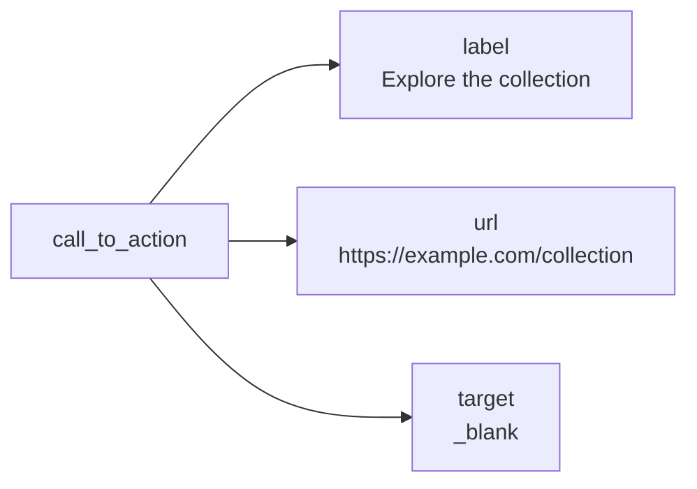
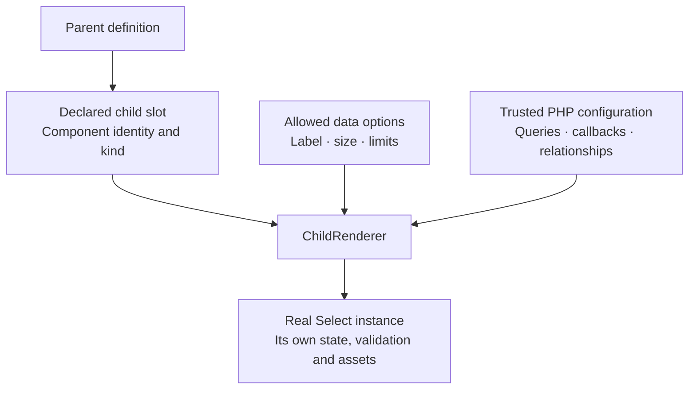
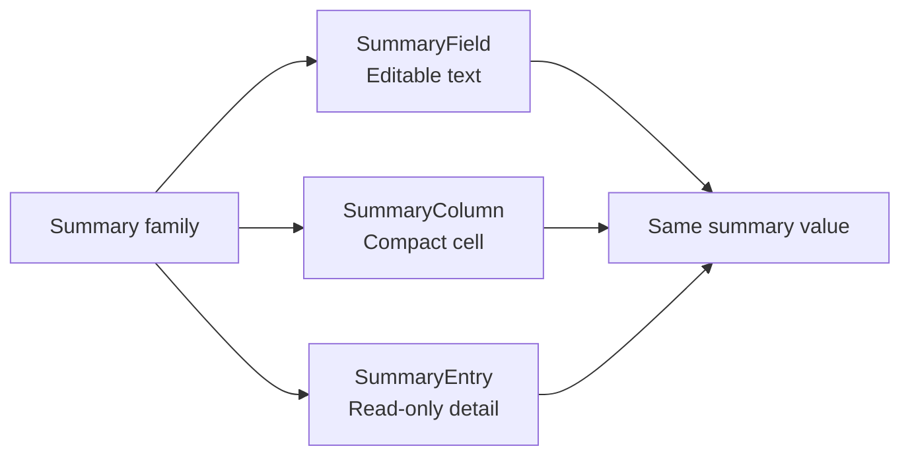

A composition can be as small as two existing fields in one layout. Choose a
named family or stored schema only when your application needs that additional
structure.

<Tip>
  **Watch this in the workshop:** [02:04 — reuse real fields](https://www.youtube.com/watch?v=m4V_R7YxTP4&t=124s) · [04:34 — position them in Blade](https://www.youtube.com/watch?v=m4V_R7YxTP4&t=274s) · [05:16 — add custom behavior](https://www.youtube.com/watch?v=m4V_R7YxTP4&t=316s).
</Tip>

## A nested field schema

A `CompositeField` wraps real fields and gives their values a shared state path.
It is useful for a call-to-action, contact card or other small structured value.
The [overview example](/docs/extensions#1-compose-a-control-from-real-fields)
combines text, a URL and a Select.



Its value can look like this:

```json
{
  "label": "Explore the collection",
  "url": "https://example.com/collection",
  "target": "_blank"
}
```

To store this particular shape as an ordinary Eloquent attribute, add a JSON
column through your normal migration workflow and an `array` cast on the model.
The following are examples to merge into your application's existing files:

```php
use Illuminate\Database\Schema\Blueprint;
use Illuminate\Support\Facades\Schema;

Schema::table('posts', function (Blueprint $table): void {
    $table->json('call_to_action')->nullable();
});
```

```php
// Add to the model's existing casts.
protected function casts(): array
{
    return ['call_to_action' => 'array'];
}
```

This is the chosen storage shape for this example. It is not a requirement to
store all fields in one JSON column. A relationship or separate SQL columns need
the corresponding application-owned mapping. For an upload composition, use the
[relational gallery recipe](/docs/file-upload-gallery-recipe) and its record-save
contract rather than treating a list of paths as a complete relationship save.

## A reusable control in your application

When the same composition appears in several forms, give it a PHP class. This
example extends the built-in composite renderer; it needs no copied Blade view
or custom JavaScript.

```php
namespace App\Forms\Components;

use Bjanczak\FilamentFlexFields\Filament\Forms\Components\CompositeField;
use Bjanczak\FilamentFlexFields\Filament\Forms\Components\FlexTextInput;
use Bjanczak\FilamentFlexFields\Filament\Forms\Components\SelectField;

class CallToAction extends CompositeField
{
    protected function setUp(): void
    {
        parent::setUp();

        $this->schema([
            FlexTextInput::make('label')
                ->label('Button text')
                ->maxLength(80)
                ->required()
                ->emojiPicker(),
            FlexTextInput::make('url')
                ->label('Destination URL')
                ->url()
                ->required(),
            SelectField::make('target')
                ->label('Open link in')
                ->options(['_self' => 'Same tab', '_blank' => 'New tab'])
                ->default('_self')
                ->required(),
        ]);
    }
}
```

Add it to any compatible form schema:

```php
use App\Forms\Components\CallToAction;

CallToAction::make('call_to_action')->label('Call to action');
```

Two instances keep independent values. You can configure the parent or replace
its schema through the supported PHP API. Labels above are application-provided
examples; use your application's translations in a multilingual project.

## Typed child slots for configurable extensions

Use a child slot when a reusable extension should declare which controls it can
render, accept validated data configuration and apply additional PHP callbacks.



The [Select composition guide](/docs/extensions/child-select) includes the complete
`ComponentDefinition`, `ChildSlot` and `ChildRenderer` example. A child slot does
not eagerly import every possible child. The child acquires its resources when
it is actually rendered and activated.

Use the child's fluent PHP API for relationship scopes and callbacks. Do not
serialize executable callbacks into stored configuration. The application still
validates access to records and owns database writes.

## A component family with several surfaces

Choose a family when the same logical value needs editing and display, for
example a Summary field, compact table column and infolist entry.



The generated [Summary package](/docs/extensions/quickstart) provides those three
surfaces. Each is an independent component. Shared display CSS belongs to one
owner; read-only views do not need the field's editing JavaScript.

A family does not automatically map its value to SQL or grant permission to edit
records. Use the application's normal form save flow and authorization. For
families selected through saved definitions, continue with
[schema adapters](/docs/extensions/schema-adapter) and
[form, table and infolist builders](/docs/extensions/schema-builders).
