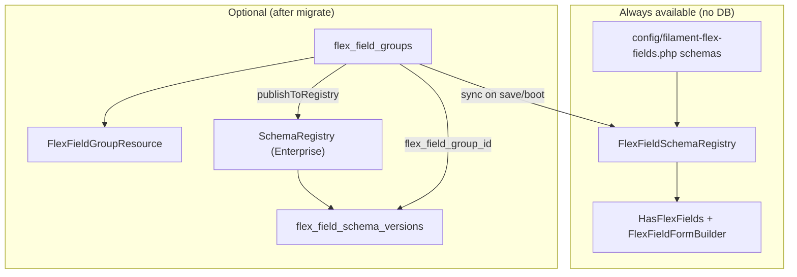

# Flex Field Groups

[← Back to Table of Contents](/docs/index)

## Why these migrations exist

Filament Flex Fields ships **three optional database tables** as part of the **M8 schema product**. They are **not required** for normal field usage, AudioField, or `HasFlexFields` with PHP/config schemas.

| Without migrations | With migrations |
|--------------------|-----------------|
| Schemas live in `config/filament-flex-fields.php` or `FlexFieldSchemaRegistry` (PHP, in-memory at boot) | Same, **plus** optional DB storage for admin-managed groups |
| `SchemaRegistry` keeps version history in memory (tests, dev) | `SchemaRegistry` can persist publish/rollback history to `flex_field_schema_versions` |
| No extra Filament nav items | Optional **Field groups** CRUD when `schema.resource_enabled=true` |

The package registers migrations via `loadMigrationsFrom`, so `php artisan migrate` on a host app **creates the tables** even when the admin resource stays disabled. That is intentional: empty tables are harmless; enabling the feature later does not require a separate migration step.

You can also publish migrations explicitly:

```bash
php artisan vendor:publish --tag=filament-flex-fields-migrations
php artisan migrate
```

---

## The three tables

### `flex_field_groups`

Stores **editable field group definitions** for the optional Filament resource.

| Column | Type | Purpose |
|--------|------|---------|
| `id` | bigint | Primary key |
| `name` | string | Display label in admin |
| `slug` | string | Stable key (unique per `tenant_id`) |
| `target_type` | string | Eloquent model class for `HasFlexFields` |
| `fields` | JSON | Array of field defs: `slug`, `label`, `type`, `sort`, … |
| `order` | unsigned int | Sort weight in list UI |
| `tenant_id` | string | Multi-tenant scope — `''` for global groups |
| `timestamps` | | Created / updated |

**Model:** `Bjanczak\FilamentFlexFields\Models\FlexFieldGroup`

**Unique constraint:** `(tenant_id, slug)` — same slug may exist for different tenants; global groups use empty string `''` (not SQL `NULL`).

### `flex_field_schema_versions`

Append-only **version history** for `SchemaRegistry` (enterprise control plane), not for individual Eloquent records.

| Column | Type | Purpose |
|--------|------|---------|
| `flex_field_group_id` | FK, nullable | Links to `flex_field_groups` when published from a group (`nullOnDelete`) |
| `schema_id` | string | Logical schema key (e.g. `crm-lead` or `tenant-a:booking`) |
| `version` | unsigned int | Monotonic version per `schema_id` |
| `schema` | JSON | Full schema payload + checksum |
| `checksum` | string(64) | SHA-256 via `SchemaImportExport` |
| `actor` | string, nullable | Who published (email, user id, …) |
| `state` | string(16) | `draft`, `review`, or `live` |
| `published_at` | timestamp | When this version was published |
| `timestamps` | | Row metadata |

**Model:** `Bjanczak\FilamentFlexFields\Models\FlexFieldSchemaVersion`

Generic `SchemaRegistry::publish()` calls may omit `flex_field_group_id`; group publishes always set it. Use `$group->schemaVersions()` for the relationship.

### `flex_field_schema_heads`

Stores the last issued and current live version for each schema ID. A locked head
serializes publication and prevents competing editors from issuing the same version.
It also retains issued version numbers when history is explicitly purged. Install
its migration together with `flex_field_schema_versions` when using persistent
snapshot history.


---

## Architecture (what talks to what)



`SchemaRegistry` (enterprise versioning) is separate from `FlexFieldSchemaRegistry` (runtime form builder), but **Field groups** sync into the runtime registry automatically when `schema.sync_on_save` / `schema.sync_from_database` are enabled (default).

| Class | Role |
|-------|------|
| `FlexFieldSchemaRegistry` | Runtime registry: which fields render on which Eloquent model |
| `SchemaRegistry` | Versioned publish / rollback / approval states for schema JSON |

---

## Do I need to run migrations?

| Your goal | Run migrations? | Enable resource? |
|-----------|-----------------|------------------|
| Use individual Flex Fields only | Optional (tables unused) | No |
| JSON fields via config / service provider | Optional | No |
| Admin UI to edit field groups in DB | **Yes** | `FLEX_FIELDS_SCHEMA_RESOURCE_ENABLED=true` |
| Persist schema version history across requests | **Yes** | No (use `SchemaRegistry` in code) |
| Multi-tenant field packs in admin | **Yes** | Yes + custom policy |

If you never enable the resource and never call `SchemaRegistry::publish()`, the tables stay empty and the package behaves like a config-only install.

---

## Enable the Filament resource

1. Run migrations (see above).

2. Turn on the resource:

```env
FLEX_FIELDS_SCHEMA_RESOURCE_ENABLED=true
```

Or in config:

```php
'schema' => [
    'resource_enabled' => true,
    'navigation_group' => 'Flex Fields',
    'navigation_sort' => 90,
],
```

3. Keep `FilamentFlexFieldsPlugin` on your panel — it registers `FlexFieldGroupResource` when the flag is true.

Navigation: **Field groups** (`/flex-field-groups` slug under your panel path).

### Flex Field Studio (Beta)

<Warning>
**Flex Field Studio is in beta and is not ready for production use.** Its interface and workflows are incomplete and may not work reliably. Keep the Studio page disabled in production. This beta notice applies to the Studio management page, not the `FlexFieldStudio` PHP integration API described below.
</Warning>

When `schema.management_page_enabled` is true, **Flex Field Studio (Beta)** lists groups per discovered entity. Each card shows the latest `SchemaRegistry` version and approval state (`draft`, `review`, or `live`) when the group has been published; otherwise it reads **Not published**.

The Studio flag currently defaults to `true`, but the page is registered only when `schema.resource_enabled` is also enabled. To use the Field groups resource with Studio disabled, set:

```env
FLEX_FIELDS_SCHEMA_RESOURCE_ENABLED=true
FLEX_FIELDS_SCHEMA_MANAGEMENT_PAGE=false
```

Or set `schema.management_page_enabled` to `false` in `config/filament-flex-fields.php`. After changing a cached configuration, run `php artisan config:clear`.

---

## SchemaRegistry persistence

When `schema.registry_persistence` is `true` (default) **and** `flex_field_schema_versions` exists, publish/rollback writes to the database. Otherwise `SchemaRegistry` uses in-memory storage (fine for unit tests).

```env
FLEX_FIELDS_SCHEMA_REGISTRY_DB=false
```

```php
use Bjanczak\FilamentFlexFields\Support\Enterprise\SchemaRegistry;

$v1 = SchemaRegistry::publish('crm-lead', $schemaArray, 'admin@example.com', SchemaRegistry::STATE_DRAFT);
SchemaRegistry::setApprovalState('crm-lead', $v1, SchemaRegistry::STATE_LIVE);
$rolled = SchemaRegistry::rollback('crm-lead', $v1); // new live version with old schema payload
$history = SchemaRegistry::versions('crm-lead');
```

States: `draft`, `review`, `live`.

Rows published via `$group->publishToRegistry()` store `flex_field_group_id` and are available through `$group->schemaVersions()`.

---

## Runtime sync (automatic)

When enabled (default), groups stay aligned with `FlexFieldSchemaRegistry`:

| Event | Behavior |
|-------|----------|
| App boot | `FlexFieldGroupRegistrySync::syncAllFromDatabase()` after config schemas load |
| Group saved | Registry entry updated (`registrySchemaId()` key, `target_type`, fields) |
| Group deleted | Registry entry removed |
| Slug / `tenant_id` changed | Previous registry key removed before the new one is synced |

**Key collision:** DB groups registered after config schemas use the same string key — a DB group with slug `crm` overwrites a config schema keyed `crm`. Use distinct slugs or disable `sync_from_database`.

```env
FLEX_FIELDS_SCHEMA_SYNC_FROM_DB=true
FLEX_FIELDS_SCHEMA_SYNC_ON_SAVE=true
FLEX_FIELDS_SCHEMA_DEFAULT_TARGET=App\Models\Model
```

Disable either flag if you prefer manual registration in your service provider.

---

## One-line Filament integration (`FlexFieldStudio`)

After a model uses `HasFlexFields` and field groups are synced to the runtime registry, wire forms, tables, and infolists without hand-building each component:

```php
use Bjanczak\FilamentFlexFields\Filament\Concerns\InteractsWithFlexFieldSchemas;
use Bjanczak\FilamentFlexFields\Support\Schema\FlexFieldStudio;

// In a Filament Resource — trait helpers
class LeadResource extends Resource
{
    use InteractsWithFlexFieldSchemas;

    public static function form(Schema $schema): Schema
    {
        return $schema->components([
            // …your core fields…
            ...static::flexFieldFormLayoutForResource('CRM attributes', collapsible: true),
        ]);
    }

    public static function table(Table $table): Table
    {
        return $table->columns([
            // …core columns…
            ...static::flexFieldTableColumnsForResource(),
        ]);
    }
}

// Or fluent API directly
$section = app(FlexFieldStudio::class)
    ->form()
    ->forModel(\App\Models\Lead::class)
    ->record($lead) // optional — resolves tenant + RBAC from context
    ->only(['deal_stage', 'company_name'])
    ->section();
```

| API | Purpose |
|-----|---------|
| `FlexFieldStudio::form()` | Build form section / components from live schemas |
| `FlexFieldStudio::table()` | Searchable, sortable table columns for JSON values |
| `FlexFieldStudio::infolist()` | Read-only entries on view pages |
| `InteractsWithFlexFieldSchemas` | Resource trait with `flexFieldFormLayout()`, `flexFieldFormSection()`, `flexFieldTableColumns()`, … |

### Sections in runtime forms

When a field group defines **sections** in the admin UI, use `flexFieldFormLayout()` (instance or static) to render one Filament `Section` per schema section, plus an optional catch-all section for ungrouped fields:

```php
use Filament\Schemas\Schema;

public static function form(Schema $schema): Schema
{
    return $schema->components([
        ...static::flexFieldFormLayoutForResource('CRM attributes', collapsible: true),
    ]);
}
```

`flexFieldFormSection()` remains available for backward compatibility: it returns a single section wrapping the layout when multiple sections exist.

Import, export, publish, and **rollback** all preserve `sections` and `section_id` on fields.

Tenant-aware resolution uses `FlexFieldSchemaResolver` (global schemas + `tenantId:slug` scoped groups). Field types can be limited per tenant via `TenantFieldPacks::registerPack()` and per user via `FieldRbacMatrix`.

---

## Filament admin workflow

On **Create / Edit field group**, header actions include:

| Action | Effect |
|--------|--------|
| **Publish workflow** (draft / review / live) | Versioned snapshots in `flex_field_schema_versions`; **live** syncs runtime registry |
| **Import JSON** | Paste `SchemaImportExport` payload — validated before apply |
| **Export JSON** | Copy portable schema JSON |
| **Apply blueprint** | Seed from `SchemaBlueprintPacks` (CRM, HR, Booking, …) |
| **Rollback to version** | Restore prior JSON + new live version row |

The repeater supports slug, label, type, sort, required flag, help text, placeholder, config JSON, and JSON condition rules (`visible_when`, `required_when`, `disabled_when`). Saves run through `FlexFieldGroupValidator` (duplicate slug detection, type checks, `FlexFieldDefinition` parsing).

Programmatic API remains on the model:

```php
$group->publishToRegistry($actor, SchemaRegistry::STATE_REVIEW);
$group->rollbackRegistryVersion(3);
```

---

## Tenant resolver & admin scoping

Register how the active tenant is resolved for schema filtering and optional admin list scoping:

```php
// AppServiceProvider::boot()
config([
    'filament-flex-fields.schema.tenant_resolver' => fn (?object $context): ?string => Filament::getTenant()?->id,
    'filament-flex-fields.schema.rbac_user_key_resolver' => fn (?object $context): ?string => auth()->user()?->email,
    'filament-flex-fields.schema.scope_resource_by_tenant' => true,
]);
```

When `scope_resource_by_tenant` is true, the **Field groups** list shows global groups (`tenant_id = ''`) plus groups for the resolved tenant.

---

## FlexFieldGroup helpers

```php
use Bjanczak\FilamentFlexFields\Models\FlexFieldGroup;
use Bjanczak\FilamentFlexFields\Support\Enterprise\SchemaRegistry;

$group = FlexFieldGroup::query()->where('slug', 'booking')->first();

// schema_id = slug, or "tenantId:slug" when tenant_id is set
$version = $group->publishToRegistry(auth()->user()?->email, SchemaRegistry::STATE_LIVE);

// Restores fields JSON (and name from schema label) from a prior version; creates a new live version in SchemaRegistry
$record = $group->rollbackRegistryVersion(1);
```

`toRegistrySchema()` returns a payload compatible with `SchemaImportExport` / blueprint packs. Set **`target_type`** on each group (or `FLEX_FIELDS_SCHEMA_DEFAULT_TARGET`) so `HasFlexFields` resolves the correct Eloquent model.

---

## Security & RBAC

Default policy requires Gate ability **`manageFlexFieldSchemas`** (configurable):

```php
// AppServiceProvider::boot()
use Illuminate\Support\Facades\Gate;

Gate::define('manageFlexFieldSchemas', fn (\App\Models\User $user): bool => $user->isAdmin());
```

Custom policy:

```php
use Bjanczak\FilamentFlexFields\Models\FlexFieldGroup;

Gate::policy(FlexFieldGroup::class, YourFlexFieldGroupPolicy::class);
```

Publish and rollback actions authorize `publish` / `rollback` on the policy. Enable `scope_resource_by_tenant` or add a custom policy / global scope for stricter tenant isolation.

---

## Slug uniqueness (multi-tenant)

- **Database:** unique index on `(tenant_id, slug)` with `tenant_id = ''` for global groups (no MySQL `NULL` duplicate slugs).
- **Filament form:** `unique` rule scoped to the same `tenant_id` value.

The same slug may exist for different tenants; not twice for the same tenant (including global).

---

## Configuration reference

```php
// config/filament-flex-fields.php
'schema' => [
    'resource_enabled' => env('FLEX_FIELDS_SCHEMA_RESOURCE_ENABLED', false),
    'management_page_enabled' => env('FLEX_FIELDS_SCHEMA_MANAGEMENT_PAGE', true), // Beta; set to false in production.
    'navigation_group' => env('FLEX_FIELDS_SCHEMA_NAV_GROUP', 'Flex Fields'),
    'navigation_sort' => (int) env('FLEX_FIELDS_SCHEMA_NAV_SORT', 90),
    'registry_persistence' => env('FLEX_FIELDS_SCHEMA_REGISTRY_DB', true),
    'sync_from_database' => env('FLEX_FIELDS_SCHEMA_SYNC_FROM_DB', true),
    'sync_on_save' => env('FLEX_FIELDS_SCHEMA_SYNC_ON_SAVE', true),
    'default_target_type' => env('FLEX_FIELDS_SCHEMA_DEFAULT_TARGET', 'App\\Models\\Model'),
    'policy_ability' => env('FLEX_FIELDS_SCHEMA_POLICY_ABILITY', 'manageFlexFieldSchemas'),
    'tenant_resolver' => null, // callable (?object $context): ?string
    'rbac_user_key_resolver' => null, // callable (?object $context): ?string
    'scope_resource_by_tenant' => env('FLEX_FIELDS_SCHEMA_SCOPE_BY_TENANT', false),
],
```

| Env variable | Default | Effect |
|--------------|---------|--------|
| `FLEX_FIELDS_SCHEMA_RESOURCE_ENABLED` | `false` | Filament **Field groups** resource |
| `FLEX_FIELDS_SCHEMA_MANAGEMENT_PAGE` | `true` | **Flex Field Studio (Beta)** page; also requires the resource flag. Set to `false` in production. |
| `FLEX_FIELDS_SCHEMA_REGISTRY_DB` | `true` | Persist `SchemaRegistry` to DB when table exists |
| `FLEX_FIELDS_SCHEMA_SYNC_FROM_DB` | `true` | Hydrate runtime registry on boot |
| `FLEX_FIELDS_SCHEMA_SYNC_ON_SAVE` | `true` | Sync registry when groups saved/deleted |
| `FLEX_FIELDS_SCHEMA_DEFAULT_TARGET` | `App\Models\Model` | Default `target_type` for new groups |
| `FLEX_FIELDS_SCHEMA_POLICY_ABILITY` | `manageFlexFieldSchemas` | Gate ability for CRUD + publish/rollback |
| `FLEX_FIELDS_SCHEMA_SCOPE_BY_TENANT` | `false` | Filter admin list by resolved tenant |
| `FLEX_FIELDS_SCHEMA_NAV_GROUP` | `Flex Fields` | Navigation group label |
| `FLEX_FIELDS_SCHEMA_NAV_SORT` | `90` | Navigation sort |

---

## Tests

`tests/Schema/FlexFieldStudioTest.php`, `tests/Schema/FlexFieldGroupResourceTest.php`, `tests/Schema/FlexFieldGroupRegistrySyncTest.php`, `tests/Schema/FlexFieldGroupEnterpriseTest.php`, `tests/Unit/EnterpriseControlPlaneTest.php` — resolver/tenant/RBAC, FlexFieldStudio form+table builders, validation, CRUD, registry sync, publish/rollback/import/blueprint Livewire actions, composite slug uniqueness.

---

## Related

- JSON schemas in config: `config/filament-flex-fields.php` → `schemas`
- Runtime builder: `HasFlexFields`, `FlexFieldFormBuilder`, `FlexFieldSchemaRegistry`, **`FlexFieldStudio`**
- Blueprint packs: `SchemaBlueprintPacks` (CRM / HR / Booking / …)
- Import / export: `SchemaImportExport`
- JSON conditions: [Schema conditions](/docs/flex-field-groups)
- Tenant access policies: `TenantFieldPacks`, `FieldRbacMatrix`
- Component monitoring: [Laravel application events](/docs/sre-runbook#application-events-and-monitoring)


## Detect simultaneous schema edits

For an editor or API that publishes snapshots, remember the schema's version when
opening it and pass that version when saving. Zero means no snapshot has been
published yet. Scope the schema ID to your tenant in application code.

```php
use Bjanczak\FilamentFlexFields\Support\Enterprise\SchemaRegistry;
use Bjanczak\FilamentFlexFields\Support\Enterprise\Schema\SchemaVersionConflict;

// Read when opening the editor, not immediately before saving.
$openedVersion = SchemaRegistry::currentVersion($schemaId);

// After your application authorizes schema configuration:
try {
    $newVersion = SchemaRegistry::publish(
        schemaId: $schemaId,
        schema: $schema,
        actor: (string) $actor->getAuthIdentifier(),
        state: SchemaRegistry::STATE_DRAFT,
        expectedVersion: $openedVersion,
    );
} catch (SchemaVersionConflict $conflict) {
    // Keep the user's changes and ask them to reload/compare the newer snapshot.
    // $conflict->expected and $conflict->actual contain only version numbers.
}
```

The version comparison occurs within the publication transaction, while the schema
head is locked. A conflict leaves history and the version counter unchanged. This
also covers the first publication. Purging history does not reuse previously issued
version numbers.

Guard rollback in the same way:

```php
$restored = SchemaRegistry::rollback(
    schemaId: $schemaId,
    version: 3,
    expectedVersion: $openedVersion,
);
```

Existing calls without `expectedVersion` retain their publication behavior. Merely
reading `currentVersion()` does not activate conflict detection. This guard applies
to schema snapshots, not automatically to ordinary record edits, the field-group
editor or every application transaction. Persistent versioning requires both the
schema versions and schema heads migrations. Request-local in-memory history is
intended for isolated uses; it is not durable shared editor storage.

## Validate exchanged schemas before saving

```php
use Bjanczak\FilamentFlexFields\Support\Schema\SchemaImportExport;

$exchange = app(SchemaImportExport::class);
$schema = $exchange->import($json); // Version, shape and bounded-data validation.
$exchange->assertValid($schema);    // Use the same checks for direct array updates.
```

Import, export, dry-run validation and publication share the built-in payload
contract. Field-group saving also checks that contract after normalizing its form
settings. Unknown versions, unexpected schema/field metadata, invalid literal paths,
overlapping field paths and invalid flags are rejected. The known legacy `required`
flag remains readable; explicit `is_required` or `isRequired` takes precedence.

Version-zero migration accepts the documented old `field`, `name`, `default` and
`required` aliases. It preserves an explicit canonical `null` or `false` and removes
redundant legacy aliases. Invalid records and future versions are rejected instead
of being replaced by empty fields.

Authorize importing/configuring a schema separately. Verify that its `target`
matches an application-approved target before applying it. The target is data;
import does not instantiate that class or grant access to its records. Built-in
configuration shape checks do not certify every component's business rules. For
external families, use their typed family schema codec and configured adapter.

Boolean switches must use `true` or `false`, including encryption settings.
Numeric limits must be finite, steps positive, and minimums cannot exceed maximums.
Numeric strings accepted by the field configurators remain supported. Length limits
must be nonnegative integers or integer strings. Optional empty widths use the
normal full-width layout; other widths must be supported enum values. These checks
also run when a field group is saved, before it is stored or published.

## Apply validated values to a record

Use `applySubmittedFlexFieldValues()` on a model using `HasFlexFields` when accepting
values from an API or another interface outside a Filament form. Define the rules
and authorization policies in your application, rather than accepting them in the
request. This method applies a patch: omitted fields keep their existing values,
while an explicitly submitted `null` clears a field whose rules allow it.

```php
use Bjanczak\FilamentFlexFields\Support\Values\Submission\FieldValueContract;
use Illuminate\Support\Facades\DB;

$contracts = [
    new FieldValueContract('title', ['sometimes', 'string', 'max:120']),
    new FieldValueContract(
        path: 'tags',
        rules: ['sometimes', 'array', 'list', 'max:20'],
        nestedRules: ['*' => ['string', 'max:40', 'distinct']],
    ),
    new FieldValueContract(
        path: 'translations',
        rules: ['sometimes', 'array:en,pl'],
        nestedRules: [
            'en' => ['sometimes', 'nullable', 'string', 'max:500'],
            'pl' => ['sometimes', 'nullable', 'string', 'max:500'],
        ],
    ),
];

$submittedValues = $request->input('flex_field_values');
$user = $request->user();
$tenant = $currentTenant; // Resolve this through your authenticated tenant context.

DB::transaction(function () use (
    $recordId, $submittedValues, $contracts, $user, $tenant,
) {
    $record = Article::query()
        ->where('tenant_id', $tenant->getKey())
        ->lockForUpdate()
        ->findOrFail($recordId);

    $record->applySubmittedFlexFieldValues(
        values: $submittedValues,
        contracts: $contracts,
        authorizeRecord: fn ($record): bool => $user->can('update', $record),
        authorizeField: fn (FieldValueContract $field): bool =>
            $user->can('updateFlexField', [$record, $field->path]),
    )->save();
});
```

The same method works on a new model; use your create policy as the record policy
and assign its tenant in trusted application code. Validation and authorization
complete before any values are changed. A rejected patch leaves the model values
unchanged. The method does not save automatically; call `save()` inside your
transaction when the patch is accepted.

Nested rules use relative paths such as `*.title` or `*.tags.*`. Validate the parent
container too: `array:title,tags` rejects unexpected map keys, `list` requires a
consecutive list, and `max:20` limits its length. Use `present` when an empty array
is allowed. Expansion is limited to 4,096 validation paths and 65,536 rules for one
submission. Overlapping expanded patterns are rejected.

Encrypted storage definitions automatically enable encryption on contracts for
those exact field paths. Text resembling encrypted data is treated as incoming
text and encrypted again as a new value. Declare an encrypted field as its own
contract; do not patch through its parent or child path. Existing stored ciphertext
in omitted fields remains unchanged.

This API keeps record permission, tenant selection, schema selection and transaction
control in your application. The trusted setters `setFlexFieldValue()` and
`setFlexFieldValues()` still prepare storage values; they do not perform these
request-level permission checks.

See [value submission and data limits](/docs/custom-components#validate-values-outside-a-form)
for saving values outside a form. Laravel documents the underlying
[transaction](https://laravel.com/docs/13.x/database#database-transactions) and
[row-locking](https://laravel.com/docs/13.x/queries#pessimistic-locking) behavior.


## Configure approved application references

Saved field configuration accepts the settings declared for that field type.
Unknown names, invalid values and conflicting aliases are rejected before a group
is saved or a form is built. Before updating an existing installation, review old
schemas and remove or migrate settings that are no longer used. The package does
not silently delete your saved settings.

If a dynamic schema selects an application model, custom option view or Livewire
method, approve that reference in your application configuration. For example:

```php
// config/filament-flex-fields.php
'schema' => [
    // Keep your other schema settings here.
    'configuration_references' => [
        'user_select' => [
            'models' => [App\Models\User::class],
            'views' => ['forms.user-option'],
        ],
        'select' => [
            'views' => ['forms.product-option'],
        ],
        'slug' => [
            'models' => [App\Models\Article::class],
        ],
        'verification_code' => [
            'methods' => ['verifyCode'],
        ],
        'todo_list' => [
            'methods' => ['loadTasks'],
        ],
    ],
],
```

`models` covers UserSelect's `option_model` (and its `model` alias) and Slug's
`spatie_model`. `views` covers `option_view` and `option_trigger_view`. `methods`
covers VerificationCode's `auto_submit_method` and TodoList's `remote_loader`.
Each category accepts up to 128 explicit references for that field type. References
are denied by default; adding one to an imported file does not approve it.

These lists apply to dynamic schema configuration. You can still configure a
component directly through its PHP methods. Approving a reference does not grant
access to records: keep your configure/view/edit policies, tenant restrictions and
model query scopes in place.

To find obsolete configuration names before deploying an update:

```php
use Bjanczak\FilamentFlexFields\Enums\FieldType;
use Bjanczak\FilamentFlexFields\Support\Schema\Configuration\BuiltinConfigurationOptions;

$type = FieldType::Select;
$unknown = BuiltinConfigurationOptions::unsupportedKeys(
    type: $type,
    defaults: $type->defaultConfig(),
    config: $savedField['config'] ?? [],
);
```

This check returns the unknown names and leaves your data unchanged. Normal schema
validation also checks the values, nested records, reference approvals and formula
dependencies. A formula stored in `config.formula` or `config.calculated` receives
the same expression and dependency checks as a formula in the field metadata.
